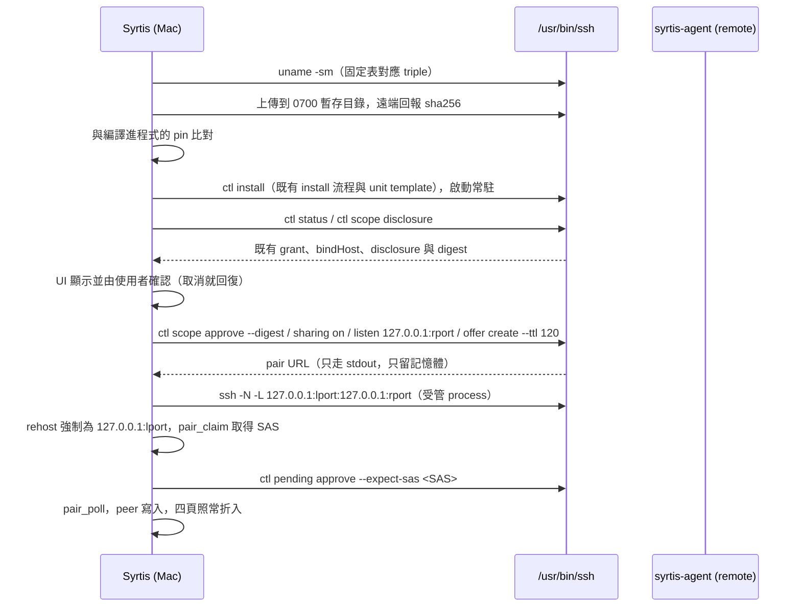

# SSH remote machines

## 文件目的

讓 Syrtis 把「只能用 SSH 連進去的遠端機器」（例如在遠端 Linux 主機上跑 coding agent 的開發機）的 agent 用量納入統計。做法是用系統 `ssh` 把常駐程式部署到遠端，並在本機保存機器清單。遠端常駐的是既有的 `syrtis-agent`，資料仍走既有的 Noise 配對與 `tb_*_devices` 折入，只是傳輸改經 `ssh -L` 轉發。

## 目錄

- [現況與缺口](#現況與缺口)
- [設計](#設計)
- [分期](#分期)
- [驗收](#驗收)
- [風險與未決](#風險與未決)

## 現況與缺口

| 已有 | 缺口 |
| --- | --- |
| Devices 頁可配對跑 `syrtis-agent` 的 producer，四頁可折入其用量 | producer 必須自己開 TCP listener，且 owner 要在 producer 端互動操作選單 |
| `syrtis-agent` 可在 Linux 執行（附 systemd unit） | 沒有任何 release binary；argv 只接受 `run`，其餘只有互動選單 |
| Pair URL 的 Noise prologue 與 secret hash 不含 host:port，只 pin `responderStatic` | consumer 沒有改寫 URL 位址的介面；`PeerRecord` 的 host:port 配對後不能改 |
| listener 允許 `127.0.0.1`，port 須 >= 1024 | — |

結論：只要遠端 agent 聽在 loopback、Mac 以 `ssh -L` 轉到固定的本機 port，並把 Pair URL 改寫成該本機位址再 claim，既有授權、快取與折入全部沿用。

## 設計

| 元件 | 位置 | 內容 |
| --- | --- | --- |
| 非互動控制命令 | [Syrtis-Agent](https://github.com/Nanako0129/Syrtis-Agent)（`ctl` 由 agent 端另一個 PR 提供，合併前本功能無法對真實主機運作） | `syrtis-agent ctl` 子命令（`status`、`install`、`uninstall`、`scope disclosure／approve`、`sharing on／off`、`listen`、`offer create／cancel`、`pending approve`、`grant revoke`），走既有 `control::Client`，以固定框架的 JSON 輸出到 stdout；不改協定 |
| Linux binary | agent repository 的 release workflow（目前上游尚未發布） | MVP 只出 `x86_64-unknown-linux-gnu`（在 ubuntu-22.04 runner 建置，glibc 下限 2.35）release asset 與 sha256；`aarch64`、musl 留到有需求再加 |
| binary 打包 | Syrtis `make remote-agent`（`scripts/stage_remote_agent.sh`） | 以 `curl --proto =https` 下載已提交的 `scripts/remote-agent.lock`（repo、tag、target、sha256 四項）所指定的 release asset，下載後的 sha256 必須等於 lock 的值（lock 是信任根；release 內的 `.sha256` 與 binary 同源，只當額外交叉檢查，不一致就失敗）。上游發布 Linux release 之前 lock 的 tag 與 sha256 留空，沒有有效 lock 又未給 `REMOTE_AGENT_BIN` 的 `make remote-agent` 會以說明訊息失敗。要用別的 release（例如 fork）有兩種方式：改 lock，或給 `REMOTE_AGENT_REPO`、`REMOTE_AGENT_TAG` 加 `REMOTE_AGENT_SHA256`（覆寫 repo 或 tag 時 sha256 必填）。通過才暫存到 `.build/remote-agent/<triple>/`，失敗會清掉暫存；`REMOTE_AGENT_BIN=<檔案>` 直接用該檔。`scripts/bundle.sh` 在簽章前複製進 app `Resources/remote-agent/<triple>/`，旁邊的 `syrtis-agent.sha256` 就是 pin：程式讀它、先與本機檔比對、再交給遠端腳本比對。pin 與 binary 由同一步產生，所以不會脫鉤，也不需要生成 Swift 原始碼，沒有 binary 的建置（CI、`swift build`）照常可用，新增機器時顯示「此版本未附遠端 agent」 |
| URL 改寫 | `tb_core_ffi`，新 `tb_remote_pair_url_rehost` | 用 agent 的 parse／encode 重產 canonical URL，host 一律強制 `127.0.0.1`、port 為該機器的 lport |
| 機器清單 | Swift `SSHMachines`（UserDefaults） | label、user、host、ssh port、remote port、local port、`producerStatic`、enabled；不存任何 secret，載入時重新驗證 |
| SSH 執行 | Swift `SSHRunner` | `/usr/bin/ssh` 加固定選項（見下），沿用使用者 `~/.ssh/config` 與 ssh-agent；上傳用 stdin 管線，不依賴 scp |
| 轉發守護 | Swift `SSHTunnelSupervisor` | 啟動時為每台 enabled 機器開轉發，退出就退避重連，關 App 時停止 |
| UI | Devices 設定頁新增「SSH machines」區塊 | 新增（user、host、port、label、確認掃描範圍）、狀態與可行動錯誤、重新核准、移除 |

### 部署與完整性

- `uname -sm` 的輸出只用固定表對應 triple（MVP 只接受 `Linux x86_64`），其他值一律拒絕，不拿遠端輸出組路徑。
- 上傳前先用一次唯讀 ssh 預檢 agent 要求的目錄（`$HOME`、`~/.local`、`~/.local/state`、`~/.local/bin`、`~/.config`、`~/.config/systemd`、`~/.config/systemd/user`，只看已存在者）；任一個 group 或 other 可寫就以 `unsafeRemoteDirs` 停下，不上傳、不改動遠端，UI 列出路徑與可複製的 `chmod go-w` 指令，不自動 chmod。
- user 與 SSH port 選填，留空就不帶 `user@` 與 `-p`，交給 `~/.ssh/config`；host 欄直接填 `~/.ssh/config` 的 alias 即可。
- 上傳、雜湊、安裝、清理合成一段程式內固定的遠端腳本，從 stdin 讀 binary：在 home 下 `mktemp -d` 建 0700 目錄、寫入、算 sha256，與腳本內嵌的 pin 相符才呼叫 `ctl install`，最後刪除暫存目錄。暫存路徑不回傳給 Mac。截斷或不符就刪除並以非零狀態結束。
- 安裝走新增的 `ctl install`，沿用 agent 既有的 `install::install`（逐層 no-follow、擁有者相符、目錄無 group／other 可寫、暫存檔 `O_EXCL`），unit 改為 `ctl` 提供的 template。
- `install` 本身不啟動服務，腳本接著啟動：有 systemd 就 `systemctl --user enable --now`；沒有就 `setsid nohup … </dev/null >/dev/null 2>&1 &`，stdio 全部重導，免得 ssh 掛住或輸出混進框架。
- 每次都上傳並驗證 sha256，不探測遠端雜湊、不因「雜湊相同」跳過。先用 `ctl status` 判斷這次流程之前的狀態（exit 127 為沒裝、4 為沒在跑，其餘為在跑）當回復基線；已在跑的 agent 會被 `shutdown`、替換、重新啟動，其他 consumer 會短暫中斷，確認畫面事先說明。

### Consent 與順序

| 步驟 | 規則 |
| --- | --- |
| 先看再動 | 確認前只做 agent 探測、必要時的安裝或啟動、`status` 與 `scope disclosure`，不開分享、不開 listener。`status` 的結果（sharing、`bindHost`、active grant 數）與這一步對 agent 做了什麼（新裝、替換、啟動、未動）一併記為基線並顯示給使用者；若遠端已有 grant 或 `bindHost`，也顯示讓使用者決定 |
| 掃描範圍 | 使用者在 UI 確認 disclosure 後才送 `scope approve --digest`，digest 原樣帶回；disclosure 預設展開，以 `Text(verbatim:)` 顯示。超過 64 行、name 超過 64 字或 value 超過 512 字時截斷並明示「已截斷」；digest 涵蓋整份 scope，看不全就不能核准，核准鍵停用並說明原因，協調器在 confirm 回 yes 後仍再擋一次。核准鍵不設 `.defaultAction`（不能靠 Return 帶過）。若遠端有其他 consumer 的 grant，提示 approve 會使它們 superseded |
| 取消或失敗 | 在同一個流程裡盡力撤銷本次做過的事，做不到就顯示手動指令，見下方「同流程回復」 |
| 配對核准 | offer TTL 120 秒。`ctl pending approve --expect-sas` 先列 pending，只有恰好一筆 `sasCode` 相符時，才用該筆 `pendingId` 與 generation 送 APPROVE；零筆、多筆或不符就不 approve、也不 reject 其他筆，並 cancel 本次 offer、以非零狀態結束 |
| 重新核准 | grant 變 `superseded` 時機器列顯示「需要重新核准」；確認後重跑 disclosure 與配對，沿用同一個 lport。新的 `responderStatic` 與已存的 `producerStatic` 不同時明示給使用者，不靜默取代；身分在 claim 後才知道，所以重新核准時 `scope approve` 排在身分確認之後、`pending approve` 之前 |
| 移除 | 經 `ctl grant revoke` 只撤銷本機這個 receiver 的 grant；`activeGrantCount` 歸零才 `sharing off`。之後忘記 peer、停轉發；可選擇 `shutdown` 加 `ctl uninstall --purge` 一併清掉遠端 state，但只在撤銷自己的 grant 後重讀 `status`、`activeGrantCount` 為 0 時才做；還有其他 active grant 就不 purge，也不關 sharing，並提示使用者還有 N 台裝置在用。SSH 連不上時，機器照樣從本機移除，並顯示要手動執行的 `ctl` 指令（不存檔、不重試） |

### 同流程回復

取消、否決、逾時或任何失敗，都由同一個回復程序在原流程裡處理，只動這次流程做過的事；不存檔、不排程重試。

| 這次流程做過的事 | 回復 |
| --- | --- |
| 遠端原本沒有 agent，由這次安裝並啟動 | 先撤銷自己的 grant 與 offer，再讀 `status`，沒有其他 active grant 才送 `shutdown` 與 `ctl uninstall`（不加 `--purge`） |
| 已安裝但原本沒在跑，由這次啟動（部署或重新核准） | 送 `shutdown` 讓它回到停止 |
| 已安裝且原本在跑，被停止、替換並重新啟動 | 舊 binary 無法還原（沒有備份），只確認它在跑；UI 在確認前就寫明這點 |
| 本次 offer、本次的 grant、本次開的 sharing | cancel offer；revoke 自己的 grant；基線是分享關閉時才 `sharing off`，基線已開分享時不碰它（`sharing off` 會撤銷所有 grant）；`ctl` 無法清 listen 位址，這次選的 loopback listener 留著（`sharing off` 會停掉它） |
| 本機：轉發 | 失敗或取消就停止；peer 在失敗時移除 |

- 回復失敗（連不上、逾時、agent 拒絕）時，錯誤連同要手動執行的指令一起顯示。第一個因連線失敗而停下的步驟之後，其餘步驟不再嘗試，直接列成指令，免得每步各等一次連線逾時。offer 取消不了就不列，它的 TTL 120 秒會自己到期。
- `approvePending` 的回覆遺失（逾時、取消、輸出不完整）時，Mac 端拿不到 `pendingId`，無法推導出 grantId。回復時基線分享是關閉的，就用 `sharing off` 一併結束孤兒 grant；基線分享已開（有其他 consumer）時無法安全結束，讀 `status`，active grant 數沒有超過預期（基線已核准範圍才算既有 grant，否則為 0）就視為沒核准，超過就顯示 `ctl status` 與 `ctl sharing off` 指令由使用者判斷。agent 以明確錯誤碼拒絕（例如 SAS 不符）代表沒核准。
- 移除時同樣：撤銷自己的 grant、必要時 `sharing off` 與 purge；連不上就顯示 `ctl grant revoke`；purge 時接著列 `ctl status`，`shutdown`、`uninstall --purge` 附條件說明，只在 `activeGrantCount` 為 0 時才執行，機器照樣從本機移除。
- 手動指令的格式是貼到終端機就能執行：`ssh [-p port] -- dest '<sh -c …>'`，內含的單引號以 `'\''` 跳脫，selftest 用 `/bin/sh` 解析並斷言 ssh 收到的最後一個參數與程式自己傳的相同。

### 威脅模型：Syrtis 代使用者經 SSH 核准配對

互動的 Devices 配對由「分享端」的擁有者在分享端核准。SSH machines 讓 Syrtis 在使用者的 SSH 登入下代為核准，這是刻意的取捨，前提與邊界如下：

| 項目 | 說明 |
| --- | --- |
| 授權依據 | 能以 SSH 登入該帳號的人，本來就是這個帳號的擁有者：他能讀同一帳號的 agent 用量、啟動 agent、經同 UID 的 control socket 操作它。`ctl` 沒有給他新的權限，只是把同一組操作變成非互動命令；agent 的 control socket 本來就只接受同 UID |
| Consent 的位置 | 在 Mac 端確認，而不是在遠端點同意：確認前只上傳、安裝、讀 `status` 與 `scope disclosure`；使用者在 sheet 看過遠端基線與掃描範圍（路徑與 client 清單）後才送 `scope approve --digest`；配對時比對 SAS（`pending approve --expect-sas`，零筆、多筆或不符都不核准） |
| 信任錨點 | ssh host key（`StrictHostKeyChecking=yes`，未知時失敗並提示先手動確認）加上 Noise 的 `responderStatic` pin；搶佔 loopback port 的人只能做 DoS，拿不到資料 |
| 不涵蓋 | 流程中途結束 app（強制結束、當機、斷電）時可能留下遠端狀態（新裝的 agent、開著的分享、grant）：Syrtis 不保存也不重試，使用者可依顯示的指令手動處理。遠端帳號本身被入侵：此時攻擊者已能讀該帳號的檔案，Syrtis 不增加也不降低這個風險；協定不送任何 Mac 端 secret，所以對 Mac 的影響限於遠端回報的聚合用量 |
| 不自動做的事 | 不自動接受 host key、不自動 `chmod`、不自動覆蓋其他 consumer 的 grant（approve 會使它們 superseded，因此事先警告）；purge 與取消後的 uninstall 在還有其他 active grant 時不執行 |
| 取消與回復 | 取消回到的是「這次流程之前」：新裝的 agent 被移除、啟動的被停止；被替換的舊 binary 還原不了，確認畫面事先說明。回復無法執行時顯示手動指令，不靜默放棄 |
| 看不全不核准 | disclosure 被截斷時，digest 涵蓋的內容比畫面多，所以不允許核准（UI 停用核准鍵，協調器再擋一次） |

### Secret 與輸入

- control token 不離開遠端；`ctl` 不經 argv 或環境變數收任何 secret。
- Pair URL 只寫 stdout，不寫 stderr，Syrtis 經 ssh 管線讀進記憶體，不進 log、argv 或檔案。
- user 與 host 限 `^[A-Za-z0-9._-]+$`，不以 `-` 開頭；ssh port 走 `-p`；argv 一律以 `--` 隔開目的地。
- 遠端命令是程式內的單行固定字串，包成 `sh -c '…'`，以 `$HOME` 絕對路徑呼叫 binary，不靠 PATH。插值只允許：整數（port、ttl）、digest `^[0-9a-f]{64}$`、SAS `^[0-9A-F]{4}-[0-9A-F]{4}$`。
- stdout 以嚴格框架解析並設長度上限，混入 shell rc 輸出就失敗。
- 錯誤訊息只取 stderr 第一行並遮蔽 `syrtis://`，只給 UI；Logger 以 private 記錄。

### SSH 選項

- 所有命令：`-T -o BatchMode=yes -o StrictHostKeyChecking=yes -o ForwardAgent=no -o ForwardX11=no -o PermitLocalCommand=no -o ControlMaster=no -o ControlPath=none -o ConnectTimeout=10 -o NoHostAuthenticationForLocalhost=no -o ForkAfterAuthentication=no -o RemoteCommand=none`（後三項擋住使用者 config 改變 host key 檢查、讓 ssh 在背景化、或在命令列命令之外再塞 `RemoteCommand`）。macOS 內建的 OpenSSH 10.5p1 以 `ssh -G -o …` 確認支援全部選項，selftest 也用內建 ssh 的 `-G` 檢查。
- 一次性命令另加 `-o ClearAllForwardings=yes -o SessionType=default -o StdinNull=no`（後者讓部署上傳不被 config 的 `StdinNull yes` 截斷；轉發不加），並設總逾時；stdout 邊讀邊檢查長度上限，超過就終止 ssh。
- 轉發：`-N -o SessionType=none -L 127.0.0.1:lport:127.0.0.1:rport -o ExitOnForwardFailure=yes -o ServerAliveInterval=30`。`ClearAllForwardings` 會清掉命令列的 `-L`，所以轉發不加，會繼承使用者 config 裡自己的 Forward 設定，視為使用者意圖。
- host key 未知時會失敗，UI 顯示「請先在終端機執行 `ssh <target>` 一次確認 host key」，不自動接受。

### Port 與連線

- lport 在新增時於 47100–47999 以實際 bind 測試取得，避開本機 agent 的 listener port 與其他機器已分配的 port，之後持久化，因為 `PeerRecord` pin 住 host:port。
- port 被佔用時顯示「本機 port N 被佔用，請移除這台機器後重新加入」；不靜默換 port。
- rport 在遠端 47100–47999 隨機取；`listen` 只驗語法、不保證綁得上，所以 claim 失敗時換一個 rport 重試，錯誤訊息寫明。同機其他使用者可佔 port 或握手槽，這只影響可用性，Noise pin 保住機密性。
- 轉發 process 的 pid 記在 App Support 的 per-machine 檔；啟動時只結束 uid 相同且完整 argv 與自己轉發規格相符的殘留 ssh。

約束：不動 `tokscale-core`、不改 `remote_pages.rs` 的折入邏輯、不改 agent 協定與 Syrtis 端的 agent pin。

## 分期

| 期 | 內容 | 完成判定 |
| --- | --- | --- |
| P0 | Agent 端（獨立 PR）：`ctl` 子命令、`install` template、release workflow 與測試；CI 產出 `x86_64-unknown-linux-gnu` binary 與 sha256 | agent CI 綠；release workflow 的 action 以 SHA pin、只由 tag 觸發、預設 `permissions: {}`、只有發布 job 拿 `contents: write`，保留 `--locked`。確認 `report.rs` 送出的欄位只有聚合值。測試涵蓋：SAS 不符、多筆 pending、pending 過期都不 approve 也不 reject 他筆；digest 不符被拒；Pair URL 不出現在 stderr；目的地他人可寫時 install 拒絕。Linux CI 上 `ctl` 把乾淨的 agent 走到有 offer |
| P1 | `tb_remote_pair_url_rehost` 與 Swift 包裝 | Rust 單元測試：改寫後可被 `parse_pair_url` 接受，`responderStatic`、secret 不變；URL 原帶別的 host 仍被改成 `127.0.0.1` |
| P2 | `SSHMachines`、`SSHRunner`、`SSHTunnelSupervisor` 與整合測試 | 假 `ssh` 測試：遠端原本有另一個 consumer 的 grant 時，取消與移除後該 grant 仍 active；斷線移除顯示手動指令；stdout 超過上限會終止；argv 帶齊固定選項與 `--`、不含 `syrtis://`；`-oProxyCommand=...` 與含 `%` 的 host 被拒；`uname` 回 `../x` 被拒；sha256 不符不安裝；rc 雜訊使解析失敗；取消後同流程回復；port 佔用與殘留 ssh 的處理。整合測試：本機 loopback agent 加本機 TCP 轉發器，完成 claim、`ctl` approve、pull；切斷轉發後 refresh 回 last good 或 stale，且不超過既有逾時 |
| P3 | Devices 設定 UI、`RemoteAgentLaunch`／`AppDelegate` 啟停接線、`make remote-agent` | `make` 建置通過、selftest 涵蓋列狀態與文案翻譯；App 內手動走完一台（需要 agent release 與真實機器） |
| P4 | 端對端與文件 | 至少一台真實 Linux 主機的用量出現在四頁；重新核准與移除各走一次；更新 `remote-agent.md` |

## 驗收

- When 使用者新增可 SSH 的 Linux 機器並確認掃描範圍，Syrtis shall 部署 agent、完成配對，該機器出現在 device 選單，選取後其用量加進四頁。
- When 使用者在確認前取消，Syrtis shall 還原這次流程對遠端做的事（新裝的 agent 移除、啟動的停止），不影響其他 consumer 的 grant；已在跑的 agent 因每次重新部署而重啟一次、被替換的舊版 binary 不還原，確認畫面事先說明。
- When 轉發中斷，Syrtis shall 自動重連；中斷期間該 device 的行為與既有 producer 離線相同（cached 或 unavailable）。
- When 遠端 grant 變成 superseded，Syrtis shall 顯示需要重新核准，並在使用者確認後恢復。
- When 使用者移除機器，Syrtis shall 撤銷這個 receiver 的遠端 grant（連不上時顯示手動指令）、停止轉發，該 device 不再出現。
- The system shall 不把 Pair URL 或 control token 寫進任何 log、argv 或檔案（由 P0、P2 測試檢查）。

## 風險與未決

- MVP 只支援 `x86_64-unknown-linux-gnu`（glibc 2.35 以上、通常有 systemd），用原生 gnu 建置，避開 `aws-lc-sys` 等 C 依賴的 musl cross-compile；其他架構與 libc 需要另外的 release asset。
- `systemctl --user` 在未開 linger 的主機登出後會停；MVP 以 nohup 為後備，不自動開 linger。
- 遠端 agent 的 `tokscale-core` rev 與 Syrtis vendor pin 可能不同，遠端與本機計價可能有差；沿用既有 producer 的同一風險。
- ssh 的 `LogLevel` 不輸出 channel 資料、`StrictHostKeyChecking=yes` 蓋過使用者 config，這兩點是假設，P2 以實跑確認。

- 遠端機器的聚合用量（model、token、小時、費用）會進到這台 Mac 的 receiver cache；機器若受組織管理，是否允許由使用者自行判斷，Syrtis 不替使用者決定。
- 假設遠端主機的 sshd 允許 `-L` 轉發。

已知限制：

- `approvePending` 的回覆遺失，又剛好遇到他人撤銷基線 grant 時，active grant 數回到預期，回復判斷沒有孤兒，可能留下一個沒有名字的 grant；數量比較無法分辨身分，需要 agent 提供 grant 身分才能根治。
- alias 自帶的 `LocalForward`、`RemoteForward` 會隨 tunnel 一起開，既有 port 被占用時 `ExitOnForwardFailure` 會讓 tunnel 失敗。建議為 Syrtis 另設不含 forward 的 alias。
- 跨版本升級後，舊版留下的 tunnel process 無法被新版 reap（PID 記錄不含啟動參數，選項改變後比對不上），結束 app 不會停掉它：`stopAll()` 只停這次執行啟動的 tunnel，`reapStale()` 對比對不上的 process 只刪 PID 記錄、不結束它，它可能一直占著本機 port，使該機器新的 tunnel 回報 `portInUse`。需要手動找出對應的 `ssh -N -L` process 並結束，再重試。

### Security review（2026-11-19）

結論：沒有 high，六項 medium／low 都已寫進上方設計。Noise 的 `responderStatic` pin 擋住了搶佔 loopback port 的人，他們只能做 DoS；未配對者只會拿到 `unauthorized`；control socket 只接受同 UID。

| Finding | 處置位置 |
| --- | --- |
| F1 上傳路徑與完整性 | 部署與完整性 |
| F2 ssh config 可能蓋掉安全選項 | SSH 選項 |
| F3 確認前就開分享 | Consent 與順序 |
| F4 target 文法與遠端 shell quoting | Secret 與輸入 |
| F5 `ctl` 契約與誤殺他筆 pending | Consent 與順序、Secret 與輸入 |
| F6 遠端回傳資料不可信 | Consent 與順序（重新核准）、P1 |

第二輪（獨立重審，從原始碼重推）：同樣沒有 high。排除的 high 候選包括：其他 UID 操作 control socket（0600 且檢查 peer uid）、搶佔 port（Noise pin，secret 握手後才出現）、安裝路徑劫持（`install` 逐層 no-follow）、`/proc` argv（只有 digest、SAS、port、ttl）、consent 自動化削弱授權（信任錨點改為 ssh host key 加 pin）、被入侵的遠端影響 Mac（協定不送 Mac secret）。

| Finding | 處置位置 |
| --- | --- |
| R1 `sharing off` 會撤銷所有 grant，取消與移除會誤傷其他 consumer | Consent 與順序（基線、取消、移除） |
| R2 移除時連不上，遠端 grant 留存 100 年 | Consent 與順序（移除連不上時顯示手動指令） |
| R3 rport 未定義、綁不上不換 port | Port 與連線 |
| R4 沒有啟動步驟、升級沒先停 | 部署與完整性 |
| R5 ControlPath 只加在轉發、缺逾時、暫存路徑回傳 | SSH 選項、部署與完整性 |
| R6 release workflow 權限與 pin | P0、binary 打包 |
