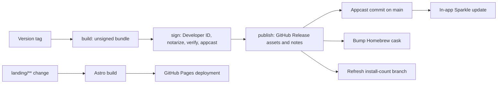

# Release and delivery

## 文件目的

這份文件描述 Syrtis 從 tag 到 appcast、GitHub Release、Homebrew、舊版遷移與 landing Pages 的交付鏈。runtime workflow 與 script 是執行 source；本文件只整理順序、邊界與已驗證的事故結論。

## 目錄

- [Delivery map](#delivery-map)
- [Application release](#application-release)
- [Local network usage description](#local-network-usage-description)
- [Developer ID signing and notarization](#developer-id-signing-and-notarization)
- [Local secret storage](#local-secret-storage)
- [Sparkle and appcast](#sparkle-and-appcast)
- [Sparkle is compiled here, not taken from the prebuilt artifact](#sparkle-is-compiled-here-not-taken-from-the-prebuilt-artifact)
- [Migration principle](#migration-principle)
- [Legacy and beta migration](#legacy-and-beta-migration)
- [Homebrew and install count](#homebrew-and-install-count)
- [Landing deployment](#landing-deployment)
- [Post-release verification](#post-release-verification)

---

## Delivery map

## Application release

The release workflow is tag-driven. It validates and bundles the native app, produces the archive and update metadata, creates the GitHub Release, publishes the appcast update, updates the Homebrew cask, and dispatches the install-count refresh. Stable and prerelease behavior is decided from the tag and release workflow, not from a hand-edited README.

**Tags are annotated, named `Syrtis <version>` without the `v`** — `git tag -a v1.18.0 <sha> -m "Syrtis 1.18.0"` — matching the GitHub Release title. An annotated tag carries its own author, date and message; a lightweight one is a bare pointer, so who cut a release and when is only answerable from the commit it happens to point at.

This is a decision, not a description. Of the 44 tags before it, 29 were lightweight and 15 annotated, alternating in runs — v1.1.0–v1.1.1 annotated, v1.1.2–v1.1.4 not, v1.5.0–v1.11.0 annotated, v1.12.0–v1.16.0 not, v1.17.0 annotated again. The message format varied too (`Syrtis 1.17.0`, `Syrtis v1.11.0`, `Syrtis v1.14.2 — Antigravity quota when the IDE is closed`). Reading a habit off the last two or three tags produces a different answer depending on which two or three, which is exactly what happened while cutting v1.18.0.

**Existing tags are left alone.** Retagging rewrites the object that 43 GitHub Releases, their appcast items and the Homebrew cask all resolve through. The inconsistency above stops at v1.18.0 rather than being tidied away.

Either form triggers the workflow identically — `push: tags: ["v*"]`, with the version read from `GITHUB_REF_NAME` — so this changes nothing about what ships. It changes what a tag can be asked afterwards.

| Artifact or action | Source of truth | Verification |
|---|---|---|
| Native app bundle | `.github/workflows/release.yml` (`build` → `sign`) with `scripts/bundle.sh`, `codesign_app.sh`, `notarize_app.sh` | `scripts/verify_signed_app.sh` passes on the app extracted from the final archive: Developer ID of the expected team, hardened runtime, no entitlements, stapled, Gatekeeper `Notarized Developer ID` |
| Sparkle archive/signature | Release workflow and Sparkle tools | EdDSA signature verifies against the published archive |
| GitHub Release body | Hand-written `release-notes/<tag>.md`, copied by `release_notes.sh` in `build`; `release_credit.sh` appends a plain-mention `Contributors:` line and GitHub's changelog tail in `publish` | Body has accurate changes, links, contribution credit, and a `Full Changelog` compare link from the previous tag |
| Sparkle / appcast text | Hand-written `release-notes/<tag>.txt`, copied by `release_notes.sh`; credit is written into it by hand | Same change set as the body, no markdown, figures agree with it |
| `appcast.xml` | `scripts/make_appcast.sh` and generated feed | XML parses, old items remain, channel semantics are correct |
| Homebrew cask | Release workflow generator plus tap repository | Version, URL, checksum, and style match the published asset |
| Install count | `update-install-count.yml` | Orphan badge branch contains the current filtered asset count |
| Discord presence artwork | Discord Developer Portal (manual, outside this repo) | Before tagging: the application's asset key matches `DiscordPresence.largeImageKey` exactly, lowercase, and still exists. Asset keys cannot be edited after saving and an unresolved key does not error — the image just disappears — so a rename adds the new key and keeps the old one |
| Discord presence consent | This repo | The opt-in switch and everything the disclosure beside it describes must reach users in the SAME release. The switch has never shipped — v1.12.0 carries the payload builder but no key, no transport and no Settings section — so today every user's first sight of it is with the current disclosure. Shipping an addition to the published surface (the repository button was the first) in a LATER release than the switch would resume publishing for anyone already opted in, under copy they never read. Either ship them together or reset the key. The `tokenbar.discord.includeDevices` checkbox (D1) follows the same rule: it ships with its caption in one release and defaults to off, so nobody who already has Discord on publishes more after upgrading. The device-approval sentence (`DevicesCopy.approveEffect`) that mentions the Discord status ships in that same release |

> **授權邊界：** 發版是不可逆的公開狀態變更。除非使用者明確要求，不能自行 tag、push appcast、改 Release body、更新 cask 或發佈 asset。

## Local network usage description

`scripts/bundle.sh` writes `NSLocalNetworkUsageDescription` into the packaged `Info.plist`. That script is the production packaging path for the release workflow and for `make selftest-bundled`. The string says Syrtis connects to providers to read quota information, and that macOS may ask for local network access when a VPN routes that traffic through a local network. The wording stays conditional: it does not say that every VPN prompts, and it does not say that the traffic stays on the machine.

Whether a tunnel-free path prompts was not measured. This document records the packaging requirement only; it does not treat a VPN as a proven cause of the dialog in every configuration.

When `SelfTest.run` is executing inside an `.app`, it reads `Bundle.main`'s actual `NSLocalNetworkUsageDescription` and requires a nonempty `String`. A missing key, a blank string, and a non-string value fail that run. A bare SwiftPM executable has no app `Info.plist`, so the same check does not apply there and `make selftest` stays valid. The check keys off the bundle being an `.app`, not the shipping bundle identifier, and it is part of the release binary rather than a `#if DEBUG` block. It reads `Bundle.main` directly, with no production helper added for the test. `make selftest-bundled` is what exercises it.

## Developer ID signing and notarization

Release builds are signed with the maintainer's Developer ID Application certificate and notarized, starting with the first release cut by the three-job workflow (2026-09). Local builds stay ad-hoc unless `SIGN_IDENTITY` is set for `scripts/bundle.sh`.

| Job | Holds | Does |
|---|---|---|
| `build` | nothing (read-only token, no Environment) | Rust + Swift build, ad-hoc bundle, release notes, `unsigned.tar` artifact |
| `sign` | `release` Environment: Developer ID .p12 + password, notary API key, Sparkle key; the tap key for an emptiness check only | Temporary keychain, re-sign inside-out, notarize (verdict from JSON, not exit code), staple, verify the extracted archive; installer DMG built, signed, notarized, stapled and verified mounted; appcast |
| `publish` | `release` Environment: tap deploy key; `contents`/`actions` write | Contributor credit and changelog range (`generate-notes` needs `contents: write`), GitHub Release, appcast commit on main, badge dispatch, tap cask |

- **Secrets live in the `release` Environment** (deployment policy: `v*` tags and `main`; required reviewer: the maintainer), never at repository level. Environment variables: `NOTARY_KEY_ID`, `NOTARY_ISSUER_ID`, `APPLE_TEAM_ID`. A `v*` tag ruleset restricts creating, moving and deleting release tags to the maintainer.
- **Dry run:** `workflow_dispatch` on `main` builds, signs, notarizes and verifies as a tag would, checks that every key the tag path reads is present, and publishes nothing; the signed archive is a one-day artifact.
- **The Sparkle key alone can push an update.** Tested 2026-09-28: an installed Developer-ID build accepted an ad-hoc update through Sparkle, so Sparkle gates on the EdDSA signature, not on the code-signing identity. The same test showed an installed ad-hoc v2.1.0 updating to a Developer-ID build, which is the path every existing user takes.
- **No entitlements.** Keychain reads go through a child `/usr/bin/security`, the Rust core is statically linked and nothing is loaded at runtime. Adding any entitlement is a maintainer decision; `verify_signed_app.sh` fails a release that carries one.
- **Installer DMG.** `Syrtis-<version>.dmg` is published beside `Syrtis.app.tar.gz`; Sparkle and the Homebrew cask keep using the tar.gz. `scripts/make_dmg.sh` assembles it with `hdiutil` from the committed layout in `assets/dmg` (see its README for why and how to regenerate it), and `scripts/verify_signed_dmg.sh` checks the DMG's signature, stapled ticket and Gatekeeper verdict, then mounts it and runs `verify_signed_app.sh` on the app inside.
- **Sparkle's XPC services are removed** by `bundle.sh`: Syrtis is not sandboxed and keeps `SUEnableInstallerLauncherService` off, and Sparkle's documentation allows removing them.

**Revocation.** A leaked notary key: revoke it in App Store Connect → Users and Access → Integrations, create a new one, replace the Environment secret and variable. A leaked Developer ID certificate: revoke it at developer.apple.com → Certificates and contact Apple; what revocation does to builds already notarized has to be confirmed with Apple's documentation at that time before relying on it. A leaked Sparkle key needs a key rotation through Sparkle's documented procedure.

**Residual risk.** The split keeps the keys away from the build, not the build away from the release: a compromised toolchain or dependency in `build` can still hand `sign` a tampered app, and it would be signed and notarized. There is no independent build-to-sign provenance check (it would need a reproducible or second build); SHA-pinned actions and a cache-free build narrow it.

**A publish that stops partway.** `publish` creates the GitHub Release, then pushes the appcast, then bumps the tap, and cannot undo an earlier step. Before re-running anything, check the three places: the release page has `Syrtis.app.tar.gz` and `Syrtis-<version>.dmg` (and `latest.json` for a stable tag); `appcast.xml` on main has an item for the version; `Casks/syrtis.rb` in the tap names the version and the archive's sha256. If it failed before `gh release create`, re-run the `publish` job. If it failed after, a re-run stops at `gh release create` because the release exists; finish the missing steps by hand from the `signed` artifact (kept one day) instead of re-tagging.

**Rollback.** Reverting to the ad-hoc chain is possible (ad-hoc updates install over Developer-ID builds, above), but the reverted workflow reads repository-level secrets, which are deleted once the Environment holds them: the maintainer restores them first. The normal recovery from a bad signed release is a new signed tag.

## Local secret storage

> 下段寫於 Developer ID 簽署之前（當時 release bundle 為 ad-hoc）。Keychain 遷移仍是另立 plan 的後續工作。

目前SwiftPM與release bundle都是ad-hoc signed；這能驗證bundle完整性流程，但不提供跨rebuild／update穩定的Developer ID designated requirement。因此provider pace的account-scope installation key不得依賴restrictive Keychain ACL，現行source of truth是hardened Application Support目錄內的exact 32-byte owner-only file（directory `0700`、file `0600`）。既有開發用Keychain item不讀取、不刪除、不更新、不遷移。

若未來release chain採用穩定Developer ID signing，可將「Developer ID-gated account-scope Keychain migration」由parked狀態另立plan。Migration必須先匯入並驗證與file完全相同的32 bytes，成功前file仍是source of truth；不得生成新key，否則既有`accountScope`與quota history會斷代。採用Developer ID本身不自動授權實作、發版或刪除舊storage。

## Sparkle and appcast

The feed is a single multi-item appcast. Stable items are channel-less; prerelease items carry the beta channel. The generator reads the existing feed, preserves prior items and signatures, and keeps a bounded history instead of overwriting the feed with one item.

This matters because a single-item writer can hide a still-valid stable version when a bridge or prerelease item is added. The appcast fix uses Sparkle's `generate_appcast` and keeps the application-side channel toggle as a lazy delegate for a possible future beta lane.

## Sparkle is compiled here, not taken from the prebuilt artifact

`scripts/bundle.sh` embeds a `Sparkle.framework` built by `scripts/build-sparkle.sh` with `SPARKLE_NORMALIZE_INSTALLED_APPLICATION_NAME=1`. The official prebuilt xcframework ships that macro off, and it is a compile-time constant rather than an Info.plist key, so no app-side declaration can turn it on. With it off, Sparkle always installs over the host bundle's existing path — an app can never change its own filename through an update. Enabling it is what allows a future rename of the installed bundle to happen through the updater instead of the app moving itself.

The macro has three consumers, all inside the framework, so one rebuild covers them: choosing the install path, switching away from the atomic swap when that path changes, and relaunching the app at the new path.

Source comes from SwiftPM's own checkout under `.build/checkouts/Sparkle`, which `Package.resolved` already pins. A separate clone would introduce a second revision to keep in sync with the one the app links against. The macro appears in none of the framework's public headers, so the app still compiles and links against the stock SPM artifact and `Package.swift` is unchanged; only the binary copied into `Contents/Frameworks` differs. Building it takes roughly two to three minutes and is skipped when the output already matches the pinned revision.

> **Updater rule：** this is the highest-consequence single point in the release chain. A defective framework breaks updating for the entire installed base at once, and the cask is `auto_updates true`, so `brew upgrade` is not a rescue channel. `scripts/bundle.sh` therefore asserts on the binary it just copied — the bundled `Autoupdate` must reference `SUNormalizedInstallationPath` — and fails the build otherwise. The assertion is on the shipping artifact rather than on source text, and it discriminates: the official prebuilt scores zero under the same check. Do not weaken it into a source scan, and do not make embedding the framework conditional; an app assembled without an updater looks fine and silently never updates again.

CI runs `scripts/bundle.sh` on pushes to `main` through `make selftest-bundled` (in `.github/workflows/ci-release.yml`, which runs beside `ci.yml`; both runs must be green before a tag, and release.yml's `gate` job, `scripts/check_ci_gate.sh`, stops the release otherwise: the tag still exists, but `build`, `sign` and `publish` need the gate and do not run), so a broken Sparkle build fails there rather than after a tag is pushed. Upgrading Sparkle now means rebuilding it here; the prebuilt artifact cannot simply be consumed again.

## Migration principle

能讓現有使用者無動作生效的遷移路徑優先；需要手動操作的步驟只作為 fallback，且任何自動化都不可越過授權邊界。

## Legacy and beta migration

The shipped native app replaced the archived Tauri app at the stable bundle identity. Stable releases re-upload a frozen legacy updater manifest, `scripts/legacy/tauri-latest.json` (the v1.20.2 `latest.json`, byte for byte, checked against a literal sha256 in `release.yml`), so a remaining Tauri install still lands on the v1.20.2 native build and Sparkle takes over from there; release notes no longer reach it, and the Tauri signing key is no longer used. The retired beta bridge cannot install a stable bundle with a different filename and bundle identity through Sparkle; its supported path is the in-app Switch action that installs the stable cask and lets the stable app migrate settings on first launch.

> **Bridge rule：** A bridge update error that says “improperly signed” can be a bundle-selection failure rather than a cryptographic failure. For the retired bridge population, use the in-app Switch path or the documented Homebrew install path; do not promise cross-identity Sparkle installation.

The bridge population is shrinking and the beta cask is not the normal installation path. Do not design new release work around increasing that population.

## Homebrew and install count

The current tap name is intentionally retained until a second app justifies a tap migration. A future migration must move all casks, delete their old copies in the same old-tap commit, retain the old public repository, and provide an app-level migration path because users who rely on Sparkle may not run Homebrew often enough to see a tap warning.

The install-count workflow writes a single JSON file to an orphan branch rather than adding a noisy commit to `main`. Its count paginates the GitHub Releases API (default page size is 30), filters assets by installable archive extensions, and intentionally excludes update metadata downloads.

## Landing deployment

The landing site is an independent Astro build. `.github/workflows/pages.yml` runs `npm ci` and `npm run build` in `landing/`, supplies the public site URL, uploads `landing/dist`, and deploys through GitHub Pages. App CI ignores landing-only changes; Pages deployment is the runtime gate for site-only changes.

Keep English and `zh-tw` copy aligned, preserve original Syrtis design, and treat the landing page as a presentation consumer of product facts rather than a runtime source.

## Post-release verification

The release notes path has two forms and two published surfaces: the GitHub Release body and the Sparkle appcast description. The legacy Tauri manifest is frozen at v1.20.2 and does not carry the current notes.

The two bodies are hand-written and bound to the tag by filename (`release-notes/<tag>.{md,txt}`), so they are deterministic and a missing one fails the release's `build` job rather than inheriting the previous version's text. What is still assembled at run time is the release body's `Contributors:` line and GitHub's changelog tail: `release_credit.sh` gets both from `releases/generate-notes` in `publish`, and any failure there stops the release before it is created. From v2.2.0 to v2.10.0 that call ran in `build` under a read-only token with its errors discarded, so eleven releases shipped with no compare range and no Contributors avatars; the avatars count only plain `@login` mentions, not the hand-written credit links to a GitHub profile. Those eleven bodies were backfilled with `release_credit.sh` on 2026-10-25, appended only. The appcast text carries no generated credit.

A durable escaping regression occurred when a note first contained literal `<`: awk replacement semantics turned `&lt;` into `<lt;`. The renderer lives in [`scripts/render_notes_html.sh`](../../scripts/render_notes_html.sh), which `make_appcast.sh` calls with the sidecar path; `make_appcast.sh` keeps the empty-notes guard, because an empty sidecar becomes an empty `<description>`. `render_notes_html.sh --self-test` renders a fixture containing literal `<`, `&`, `>`, an already-escaped `&lt;` and `]]>`, compares the result byte for byte, and runs in CI's release-notes contract step, so a broken `esc()` in the shipping file fails there. `>` is escaped even though HTML does not need it, because the output is embedded in CDATA, where a raw `]]>` ends the section; whether `generate_appcast` splits it when embedding is unverified, and escaping removes the question.

Changes to anything else on the path from `release-notes.txt` to the appcast `<description>` must still render every committed `release-notes/*.txt` before and after and show the output is byte-identical, or explain each difference. Writing the notes themselves does not touch that path.

| After release | Check |
|---|---|
| GitHub Release | Claims match the actual diff; no previous release fix is re-claimed |
| `appcast.xml` | Description is accurate HTML, item/channel/enclosure/signature are intact |
| Legacy metadata | `latest.json` on the release is the frozen v1.20.2 manifest, unchanged (sha256 `c39de81d…`), and the archive URL it names still returns 200 |
| Homebrew | Cask points to the new release and checksum matches the asset |
| Landing | Pages build and the deployed route serves the expected locale and assets |
| Update path | Stable app can discover the new stable item; bridge behavior is described honestly |

If wording is wrong, fix the published text without rebuilding the app when possible. Do not treat a release-note correction as permission to create a new release.
