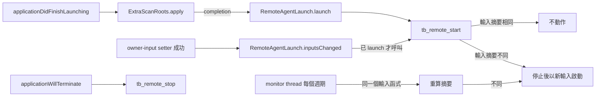

# Embedded remote-usage agent

## 文件目的

Syrtis 在 `tb_core_ffi` 內嵌 `syrtis-agent`（公開的 [Syrtis-Agent](https://github.com/Nanako0129/Syrtis-Agent/tree/f5e09711375097b44f6332cabe182ee056ec8e08) ）：同一個行程裡一個 agent，負責配對、授權、Noise 傳輸、快取與分享開關。這份文件記錄它在 App 裡的接線：誰計算什麼、何時啟動與重啟、根目錄怎麼決定、C ABI 的形狀，以及驗證位置。它不重述 agent 的協定，那些以 agent repo 的 `spec/` 為準。

## 目錄

- [分層](#分層)
- [生命週期](#生命週期)
- [Agent 根目錄](#agent-根目錄)
- [C ABI](#c-abi)
- [遠端折入四頁](#遠端折入四頁)
- [Settings 的 Devices 頁](#settings-的-devices-頁)
- [Dashboard device selection](#dashboard-device-selection)
- [Pricing 複製](#pricing-複製)
- [單一引擎與依賴 pin](#單一引擎與依賴-pin)
- [殘餘風險與未觀察的行為](#殘餘風險與未觀察的行為)
- [驗證](#驗證)

---

## 分層

| 層 | 計算什麼 | 不做什麼 |
|---|---|---|
| `syrtis-agent` | 配對、grant、授權判定、Noise 傳輸、receiver 快取、分享開關的狀態轉移、掃描範圍的核准紀錄、遠端報表（經由引擎） | 不讀環境變數；掃描輸入全由呼叫端給 |
| `tokscale-core`（vendor） | 掃描、解析、去重、計價、聚合，本機與遠端報表共用 | — |
| `crates/tb_core_ffi/src/remote_agent.rs` | 持有一個 `Agent`、轉換參數、呼叫 agent、把結果包進既有 JSON envelope、複製 pricing 檔、對單一 producer 呼叫 `Runtime::pull`／`last_good` | 不重做任何協定步驟；管理操作走 agent 自己的 control socket |
| `crates/tb_core_ffi/src/remote_pages.rs` | 逐 producer 檢查 record 是否在請求範圍內與筆數上限、交給 `merge::combine` 加總、把合併後的 record 以整數 saturating 加進本機 payload、重算衍生值、產生 `devices` | 不改本機那一份的計算（只選本機時直接跑既有函式）；不寫任何快取 |
| Swift（`RemoteAgentLaunch`、`TBCore`） | 決定 agent 根目錄、何時呼叫 start／stop、decode payload | 不計算任何授權或聚合；不過濾、不加總 |

凍結的 control 命令（offer create／cancel、pending list、approve、reject、revoke、listen configure、status）一律以 `control::Client` 打 agent 自己的 socket；control token 每次呼叫時從 state store 讀出、只留在記憶體裡。`remote_agent.rs` 直接呼叫的只有 `Runtime::enable_sharing`／`disable_sharing`／`remove_peer`、`Agent::approve_scope`、receiver 端的 `PairingClient`、`PeerStore` 與 `security::parse_pair_url`（目的地預覽），以及 `set_listen_config`：凍結的 listen 命令不帶 node label，所以先送 listen 命令，再以讀回的 host 與 port 寫入 label。agent 只收通過 `security::valid_node_label` 的**新** label（先轉 NFC；與已存的相同就不再驗），而這個拒絕若發生在第二步，位址已經改了。所以 label 有變時，`listen_configure` 先用已存的 host 與 port 單獨寫一次 label（agent 自己的驗證，`unicode-normalization` 不是這個 crate 的直接相依，無法在這裡重做 NFC）：不合格就回 `invalid`、位址、監聽與 label 都不動；之後的位址步驟失敗則把舊 label 寫回（盡力而為）。

## 生命週期

- **啟動時機**：`ExtraScanRoots.apply` 的 completion，也就是 scan registry 裝好之後；sharing 依 agent 儲存的狀態（新 root 為關），listener 只在儲存過 `bindHost` 時啟動。
- **輸入快照**：`tb_remote_start` 每次呼叫都在 agent 的鎖內重新讀取掃描輸入（`LocalSourceContext::scanner_settings`：extra scan roots、OpenCode DB、Cursor 接管），算出 `ownerInputsSha256`。與執行中的 agent 相同就不動作；不同就停止並以新輸入啟動，新輸入在 owner 核准前 `scopeApproved` 為 false，既有 grant 的報表請求被拒。
- **觸發重算的 setter**：`tb_set_extra_scan_paths` 成功之後（`ClaudeExtraRoots.install`，涵蓋 Claude、Pi、DSH 的 roots）與 `tb_set_cursor_sync` 成功之後（`CursorSync.coreSetConfig`）。launch 之前這兩處不啟動 agent。
- **週期重算**：沒有 setter 的輸入（手改 tokscale `settings.json` 的 `opencodeDbPaths`）由 monitor thread 負責。啟動時保存的那個輸入函式（同一個 home override、同一組來源）每個週期（產品 5 分鐘）再跑一次，與 `tb_remote_start` 走同一段 `ensure`：摘要相同不動作，不同就重啟，scope 隨之變成未核准。所以 owner 移除的資料庫最多再被分享一個週期。輸入無法再建立時（例如 override home 不再安全）agent 會被停止，不繼續以舊範圍服務。monitor 每個 `RemoteAgent` 一條、只持有弱參照，與 start 共用同一把鎖。monitor thread 開不起來時 start 會停掉剛啟動的 agent 並回 `internal`，不留下一個不會重算輸入的 agent。monitor 的每個週期只有 `tick()` 包在 `catch_unwind` 裡：某一個週期 panic（例如輸入函式 panic）時 payload 直接丟棄、不記錄也不計數，下一個週期照常執行；沒有這層保護時 thread 會結束、`monitor` 旗標卻仍為真，之後的 start 不會再開新的 monitor，agent 會以舊 scope 一直分享下去，改過的掃描輸入與價格表都不再被處理（Windows 版相同）。`tick` 與其呼叫的鎖都經 `lock`／`read`／`write` 這幾個容忍 poison 的函式取得，持有寫鎖時 panic 不會讓之後的呼叫跟著 panic 或卡住。`tb_remote_start` 的錯誤與執行狀態：agent 執行中而輸入無法建立（`make()` 失敗，快路徑或寫鎖路徑都算）時，start 會像 `tick` 一樣先停掉執行中的 agent（寫鎖下取出、鎖外丟棄，同 `stop`）再回同一個錯誤類別，所以「因輸入失敗而回錯誤」就代表沒有 agent 在執行，不會出現回報停止、實際仍分享最多一個 monitor 週期的狀況。輸入沒變的快路徑上，讀取狀態（`status_of`）失敗是另一回事：多半是暫時的，也與輸入無關，start 回那個錯誤、執行中的 agent 維持原樣。
- **停止**：`applicationWillTerminate` 在背景 queue 呼叫 `tb_remote_stop`，最多等 2 秒。
- **失敗**：啟動失敗（另一個行程持有 root 的 owner lock、root 不安全）只回 error envelope，App 其他功能不依賴 agent。`RemoteAgentLaunch` 以 `remote-agent` 類別的 Logger 記下失敗：只有純字母的類別字串以 public 記錄，其他一律記固定訊息。

## Agent 根目錄

`RemoteAgentLaunch.homeOverride` 是唯一的判定，App 與 selftest 共用：

| 條件 | 結果 |
|---|---|
| `BuildIdentity.shipping() != nil`（正式 bundle id、沒有 `--selftest`／`--smoke`／`--demo`／`--icon-gallery`）且非 `DEBUG` 建置 | `nil`：Rust 以 directory service 的 home 與凍結 suffix 開啟真正的 agent root |
| 其餘一律（裸執行檔、`make run`、selftest、暫時 bundle id、`DEBUG` 建置） | `/tmp/syrtis-agent-dev-<uid>/<bundle id 或 bare>`，root 為其下的 `a` |

開發用的目錄由 Rust 以 `0700` 建立；home 本身必須是本使用者擁有的實體目錄（不是 symlink），上層目錄必須屬於本使用者或 root。用 `/tmp` 與短 suffix 是因為 control socket 的路徑必須放進 macOS `sun_path` 的 104 bytes。macOS 開機時清空 `/tmp`，所以開發版的配對不會跨過重開機。`tb_core_ffi` 的測試建置收到 NULL home 時回 `homeRequired`，不開啟真正的 root。

掃描用的 config 與 data 目錄由 `inputs_from` 的兩個分支（產品的 trusted home、開發用的 override home）都以 `syrtis_agent::cli::default_dirs(&home)` 算出：`home/.config` 與 `home/.local/share`，與獨立版 agent 是同一個函式，只依 home 決定，不讀 `$HOME` 或任何環境變數，也不經 `dirs` crate（它讀 `$HOME`）。引擎的 remote context 以 data 目錄當 XDG data root、以 `<config 目錄>/tokscale` 當 config root。先前兩個分支在 macOS 都是 `Library/Application Support`，分享因此掃不到本機報表找得到的十個 client：放在 `~/.local/share` 的 OpenCode、Amp、Kilo、Crush、MiCode、Muse、Octofriend，與放在 `~/.config/tokscale` 的 Antigravity、Trae、Warp。`tb_remote_scope_disclosure` 的 `configDir`／`dataDir` 顯示的就是這兩個目錄（Devices 頁只顯示它回的值）。這兩個值是 owner inputs 的一部分，所以這次改變讓 `ownerInputsSha256` 改變：先前核准的範圍要重新核准，核准後 deny floor 提高、既有 grant 變 `superseded`，既有配對都要重做（Devices 功能未發版）。產品分支（`product_roots`）在測試建置回 `homeRequired`，沒有單元測試，只由真實資料的探測涵蓋。

## C ABI

全部回既有 envelope；`err` 只會是固定的類別字串，不含路徑、token、Pair URL 或位址。`tb_remote_*` 內的 panic 回 `panic`，不帶 panic 文字。只在 macOS 與 Linux 匯出（`#[cfg(unix)]`）；Windows 端（`SA-4`）目前沒有這些符號。

| 函式 | 成功資料 |
|---|---|
| `tb_remote_start(home_override)` | status 物件 |
| `tb_remote_stop()` | `{"running":false}` |
| `tb_remote_status()` | `{"running":false}`，或 control `status` 的欄位（含 agent 以 `Agent::scope_approved` 提供的 `scopeApproved`）加上 `running`、`listening`、`identityFingerprint` |
| `tb_remote_sharing_set(enabled)` | `null`；開啟中再開 → `invalid`，enable gate → `busy` |
| `tb_remote_listen_configure(host, port, node_label)` | status 物件 |
| `tb_remote_scope_disclosure()` | `{home, configDir, dataDir, extraScanPaths, excludedScanPaths, opencodeDbPaths, clients, ownerInputsSha256, envRootsSet, envRoots}` |
| `tb_remote_scope_approve(owner_inputs_sha256)` | `null`；摘要不是執行中 agent 的 → `invalid`、不寫入 |
| `tb_remote_offer_create(ttl_seconds)` | `{expiresAt, offerId, pairUrl}` |
| `tb_remote_offer_cancel(offer_id)`、`tb_remote_approve`／`tb_remote_reject(pending_id, sas_generation)`、`tb_remote_revoke(grant_id)` | control 命令的資料（`null`） |
| `tb_remote_pending_list()` | `[{expiresAt, pendingId, sasCode}]` |
| `tb_remote_grants()` | `[{grantId, peerFingerprint, createdAt, expiresAt, state}]`；`state`＝`active`／`revoked`／`expired`／`superseded`（紀錄仍是 active，但之後的掃描範圍核准把 generation 往前推、deny floor 提高，它已不能授權；Devices 頁只列 `active`，所以這種裝置不再顯示為可存取）。`expiresAt` 照舊 decode，Devices 頁不顯示（DR-3b） |
| `tb_remote_pair_destination(pair_url)` | `{host, port}`：claim 會連去的位址。與 `pair_claim` 同一個 effective now（OS 時鐘，不低於 state 的 last accepted wall time）、同一個 `security::parse_pair_url`；不連線、不保存、不記錄，回覆只有這兩個 key（不含 secret、`offerId`）。`invalidOffer`（格式、canonical、長度）、`expired`、`notRunning`、storage 類別 |
| `tb_remote_pair_claim(pair_url)` | `{handle, sas, expiresAt, producerFingerprint}` |
| `tb_remote_pair_poll(handle)` | `{producerStatic, fingerprint, expiresAt}`；最多阻塞凍結的 960 秒 poll window，成功時寫入 `peers.json`。等待期間 agent 若換到另一個 identity 重啟 → `identityChanged`，什麼都不寫 |
| `tb_remote_peers()` | `[{producerStatic, fingerprint, nodeLabel, host, port, createdAt, expiresAt, state}]`；`host`／`port` 是配對時領取的邀請上的位址；`nodeLabel` 是對方最近一次回覆給的名稱（DR-2b：agent 在每次成功的 pull 後存進那筆 record，已通過 agent 的名稱規則；第一次回答前、對方沒設或設了不合格的名稱時為 `null`），是對方主人的自由文字，只能當資料顯示；`expiresAt` 照舊 decode，Devices 頁不顯示（DR-3b） |
| `tb_remote_peer_remove(producer_static)` | `null`；`Runtime::remove_peer`：先從 `peers.json` 移除（失敗就回錯誤），再刪掉當下已存在的那台的 receiver cache entry（刪除失敗不改結果；同時進行的 pull 可能再留下一個沒有紀錄讀得到的 entry，到期清除） |

指紋是 static key 的 SHA-256 前 8 bytes（16 個小寫 hex），給人比對用，不是識別碼。`envRoots` 列出本行程設定了哪些 client 的根目錄環境變數（`CODEX_HOME` 等）：本機頁面會跟著它們，分享的來源不會，所以 owner 在本機看到的與分享出去的可能不同。Swift 的 `RemoteOffer` 的 `description` 不含 `pairUrl`。

## 遠端折入四頁

四個帶裝置選擇的入口（`#[cfg(unix)]`），回傳既有 payload 的同一個形狀再加四個頂層 key：

| 函式 | 本機那一份 |
|---|---|
| `tb_graph_devices(year, devices_json, timezone, mode)` | 只選本機：`tb_graph` 的同一段（含 30 秒快取）；有選 producer：`usage_graph::compute` 重新計算，不讀也不寫 `GRAPH_CACHE` |
| `tb_model_report_devices(year, devices_json, timezone, mode)` | `model_report::run`／`compute` |
| `tb_hourly_report_devices(year, clients, devices_json, timezone, mode)` | `hourly_report::run`／`compute`；`clients` 也原樣送給 producer（排序、去重） |
| `tb_agents_report_devices(year, clients, devices_json, timezone, mode)` | `agents_report::run`／`compute`；同上 |

- `devices_json`＝`{"local": bool, "peers": ["<64 個小寫 hex 的 producerStatic>", …]}`：至少一個來源、`peers` 最多 16 個、不得重複，否則 `invalid`。`mode`＝`cached`（只用本機與各 producer 的 last-good，不連線）或 `refresh`（逐一 `Runtime::pull`，不用 `Agent::pull_all`：它拉所有 peer 且回傳已加總）。`timezone` 是 IANA 識別字，**呼叫端必須傳本機那一份計算時用的時區**（行程自己的時區）：遠端的時槽與日期用這個時區，本機的用行程的時區，兩者不同時會把兩個時區的時槽併進同一份 payload，而 Rust 端不檢查（判斷不出本機報表用的 IANA 名稱）。Swift 的包裝不開放這個參數，一律傳 `TimeZone.current.identifier`。先以引擎的 `aggregate_remote_usage_v1` 驗證查詢，內建 tzdb 不接受時該次所有 producer 標為 `incompatible`、不送出任何請求。
- 加上的 key：`devices`（每個來源一列 `{id, label, state, lastSuccessAt}`，選了 producer 時另有 `reason` 與 `totals`，producer 的列再加 `address`、`costIncomplete`、`everAnswered`，見下；本機在前、其餘依 `peers` 的順序）、`duplicateWarning`（選了兩個以上來源）、`saturated`（某個加總封頂）、`remoteRangeLimited`（all time）。只選本機時 data 與既有函式逐 byte 相同，另加這四個 key。
- `id`：`local`、producer static 的 16 hex 指紋，或 `peers`（`peers.json` 讀不到、agent 沒在跑時多出的說明列）。`label`（DR-2b）：producer 的列是對方的名稱（record 的 `node_label`，在這次 pull 之後重讀，所以第一次回答的名稱就是這次顯示的），沒有名稱才是配對時存下的 `host:port`；本機為 `null`。名稱是對方主人的自由文字，Swift 只能把它當 `%@` 參數或 `Text(verbatim:)`。`address`（只在 producer 的列）：record 的 `host:port`（IPv6 加方括號），不論有沒有名稱都在，另給是為了畫面仍要有地址可看（設定頁）。`costIncomplete`（只在 producer 的列）：**這一頁實際合併進去的那份 body**（fresh 或 cached／last-good）說對方的價格表缺或壞（`Fetched::cost_incomplete`、快取解碼的 `ReportResponse::cost_incomplete`）；沒有 body 或那份沒被合併時為 `false`。`everAnswered`（只在 producer 的列）：`Runtime::ever_answered`，這個 producer 在 receiver cache 裡有過任何成功的 body；cache 被清掉（撤銷、過期、`remove_peer`、淘汰）或舊 schema 的條目被丟棄後為 `false`，直到下一次成功的 pull。`lastSuccessAt`：本行程內這個 producer、這個查詢最近一次 fresh 的 Unix 秒；行程重啟後未知。
- `state`：本機 `local`；拉取成功 `fresh`；拉取沒有回應而用 last-good、且 `lastSuccessAt` 已知 `lastGood`，未知 `stale`；沒有資料 `unavailable`；回覆的筆數超過上限、或合併時為它保留記憶體失敗，整台不納入 `overLimit`（讀快取本體時的解碼預留失敗仍是 `unavailable`）；被拒（含 `Rejected`）`refused`；回覆無效或 record 落在請求範圍外 `invalidReply`；查詢不被接受、或對方回錯誤碼 6（`FetchError::Incompatible`：對方的報表 schema 與這個 App 不同）`incompatible`（兩種都不走快取，也沒有 `reason`）；同一個 `host:port` 有 `createdAt` 較新的紀錄（producer 重設身分後重新配對）`stale`，兩種模式都不讀也不送請求。
- `reason`（只在選了 producer 的呼叫裡出現，其餘為 `null`）：`fetch()` 在 `merge::classify` 把失敗併成三類之前記下原因，與 `state` 並列回傳：`unreachable`（`Transport`）、`timeout`、`busy`（`Busy`、`TooMany`）、`stopped`（`Revoked`、`Expired`、`Unusable`、`CheckGrantStatus`、`NoPeer`）、`error`（`Internal`、`Rejected`）；`TooLarge`、`Memory`、`InvalidQuery`、`Protocol`、`Invalid` 沒有自己的原因。`state` 的判定不受 `reason` 影響。Swift 的狀態列靠 `state` 加 `reason` 選句子。
- `totals`（Graph 與 Models 頁，選了 producer 時；Hourly、Agents 為 `null`）：該裝置被計入合併頁的那一份，每個 client 一筆 `{client, messages, tokens, costUsd}`，依 client 排序。producer 的份量取自通過範圍與上限檢查、`combine` 加總之前的 record（`assemble`，只有 `fresh`／`lastGood`／`stale` 的才有，其餘 `null`）；本機那一列取自 fold 之前的本機結果（`graph_totals`／`models_totals`，Graph 取 client 列的五項 token 相加）。只選本機時 `devices` 與既有輸出逐 byte 相同（沒有 `reason`、`totals`）。各列加總＝合併頁的總數（`dr2a_device_totals_sum_to_the_merged_page`；cost 為浮點加法的次序差，容許 1e-9）。Swift 唯一的加總是「挑出畫面上的 client 集合、把 core 給的這些列相加」（`DeviceTotals.rows`）。
- 遠端範圍：指定年份＝該年 1 月 1 日到次年 1 月 1 日；all time＝到今天為止（end 為明天、不含）的 370 天，`remoteRangeLimited: true`。本機範圍不變。
- 每個 producer 的 record 先檢查再相加（凍結的 record 驗證不比對請求）：Graph 的 `date` 在 `[startDate, endDateExclusive)`、Hourly 的 `bucketStartUnixMs + utcOffsetSeconds`（時槽就是由它算出）在該範圍的毫秒視窗 `[startDate, endDateExclusive)` 之內（checked 運算），否則整個 producer 排除。凍結的驗證不限制 `utcOffsetSeconds`，只看 bucket 的話，producer 可以用好幾年的 offset 把數字挪進別年的時槽。不需要放寬：引擎只保留本地日期在範圍內的訊息，bucket 起點的本地日期與小時就是訊息的、offset 就是它回報的那個，所以正確的 record 的本地時間一定落在請求的日期。單一 producer 超過 32,768 筆、或累計超過 131,072 筆時，超過的那個 producer 整份排除。cached body 的 decode 與相加期間持有的 record 向 `remote_pages` 自己的 `MemoryLedger`（上限同 agent 的 384 MiB）預留；runtime 的 ledger 不公開。
- 相加：`merge::combine` 先把 producer 之間的 record 加總（u64、saturating），再加進本機：u64 轉 `i64`／`i32` 時封頂並設 `saturated`，`costNanoUsd` 只在最後一步轉成美元。Graph 依日期、client＋model＋provider 合併（`None` 與空字串視為同一個），重算 intensity（引擎同一條規則的副本，以 parity 測試釘住）、`calculate_summary`、`calculate_years` 與日期範圍。Models 依 client＋model＋provider 合併，`msPer1kTokens` 由合併後的 duration／timed tokens 重算；含遠端份量的列 `costEstimate` 一律為 `null`。Hourly 以 `bucketStartUnixMs + utcOffsetSeconds` 換成查詢時區的 `"YYYY-MM-DD HH:00"`（producer 以該時區算出 offset），`clients`／`models` 取聯集排序。Agents 依 agent 合併，`clients` 取聯集。排序與 total 依引擎的規則重算。
- `CheckGrantStatus`（錯誤碼 2）：以 `PeerRecord` 的 host、port、responder static 問一次 Grant status（`remote_agent.rs` 的 `check_grant`，回報結果）；`active` → `PeerStore::update_grant`，`revoked`／`expired` → `PeerStore::set_state`。只有答案是 `active` **而且** `update_grant` 成功時，`pull_peer` 以更新後的 record 再拉**一次**，回傳那一次的結果（成功就照常記下 `lastSuccessAt`；第二次又是錯誤碼 2 就原樣回傳，不再問、不迴圈）；答案是 `revoked`／`expired`、Grant status 失敗、或 `update_grant` 失敗都不重拉，該列為 `refused`（`reason: stopped`）。重拉與第一次在同一把 agent 讀鎖內（`check_grant` 也在鎖內）。producer 對錯誤碼 2 的請求不扣 per-grant 額度（agent `spec/report-peer-v1.md` 的〈Limits〉：額度在授權之後才計），所以重拉不會因為這一次被拒成 `busy`。DR-3a 起任何一台重新配對都會讓其他已連結裝置的 `authEpoch` 重新編號，沒有重拉時它們各自要顯示「已停止分享」直到下一次 poll（最多 5 分鐘）。`pull_peer` 只有 `remote_pages::fetch` 一個呼叫端，`check_grant` 只有 `pull_peer`。
- 序列化：`remote_pages` 一把 mutex 讓 `refresh` 排隊（`cached` 不連線，不排隊）。agent 的 slot 是讀寫鎖：pull、last-good、peer 讀取與管理操作都拿讀鎖，所以一個卡住的 fetch 不擋 `cached` 呼叫或管理操作；只有輸入改變後的重啟與 `stop` 拿寫鎖，它們會等進行中的 fetch 結束（一次 pull 最多 `FETCH_DEADLINE` 135 秒；被 code 2 拒絕後更新 grant 再重試的那條路徑在同一把讀鎖下 pull 兩次，加上一次 Grant status，最長約兩倍），所以在舊 agent 上開始的 pull 不會寫進新的 agent。等寫鎖期間，之後的呼叫排在它後面。輸入沒變的 start 與 monitor 週期只拿讀鎖。
- 相加以 map 找列（Graph 每天的 client＋model＋provider、Models 的 client＋model＋provider、Hourly 的時槽、Agents 的 agent），clients／models 以集合收集後一次寫出，所以一個 producer 的 32,768 筆不同 record 不會讓折疊變成平方時間。
- Swift：`TBCore.graphDevices`／`modelReportDevices`／`hourlyReportDevices`／`agentsReportDevices` 回 `DeviceAwarePayload<T>`（`payload`、`devices: [RemoteDevice]`、三個旗標），不是頁面原本的型別，型別不符會讓誤用在編譯時露出來；但 `payload` 是公開欄位，型別本身擋不住有人把它交給 `apply`。含遠端的資料不進 `SnapshotStore`、不取代 tray 與快照用的本機 payload，靠的是呼叫端不把它交給 `apply`，由 `SA3D` selftest 守（見下一節）。
- 查詢送給 producer 的只有凍結 request 已登記的欄位（範圍、時區、clients），而且只送給選中的 producer。

## Settings 的 Devices 頁

Settings sidebar 在 Accounts 與 General 之間的 Devices 頁（`DevicesSettingsView`）。頁面只呼叫 `TBCore.remote*`（經 `DevicesModel.swift` 的 `DevicesRemoteClient`），顯示回傳內容，並把固定的錯誤類別對應到 `DevicesCopy` 的文案；授權、摘要、配對與 grant 的判定都在 agent。`DevicesModel.shared` 是行程層級的單例（`SettingsPanel` 切頁會重建頁面），呼叫在背景 task 上進行；頁面顯示時每 2 秒輪詢刷新；頁面消失時取消的是這個輪詢 task，它進行中的那次刷新在每次呼叫之後檢查取消、不再呼叫也不寫入。由按鈕動作或配對等待結束觸發的單次刷新不屬於輪詢 task，頁面消失時不會被取消，會跑完並更新狀態；`tb_remote_pair_poll` 在自己的 `Thread` 上等待。

| 區塊 | 內容與規則 |
|---|---|
| 分享這台 Mac | 服務狀態與「重試」（`RemoteAgentLaunch.start` 同一條路徑）；分享開關只在 `scopeApproved` 時可開、關閉一律可按；裝置名稱（送出前 `DevicesModel.cleanedName` 清理：移除控制字元、U+2028／2029、U+061C、U+200E／200F、U+202A–202E、U+2066–2069，去頭尾空白；剩下沒有可見字元就是沒有名稱；欄位顯示清理後的值；清理後 ≤128 bytes；欄位下一行小字說已連結的裝置會看到這個名稱；名稱會送給已連結的裝置，掃描範圍的說明有一句這麼說）、監聽位址（下拉選單：「僅本機」、`getifaddrs` 的非 loopback IPv4 與 IPv6 unique-local `fc00::/7`（Tailscale 等），再加上已設定的位址與目前的選擇；global IPv6 不列，因為一台 Mac 常有十幾個會輪替的隱私位址，而清單不讀每個位址的 flag、分不出穩定的那個（已知限制：選不到新的 global IPv6）；不含 `0.0.0.0`／`::`、loopback、link-local；選擇不在清單內時顯示「選擇位址」且不能套用）、port 1024–65535；沒有位址或 `listening` 為 false 時顯示連不到；公開 IPv4 或 global IPv6 顯示可能從網際網路連到。邀請：Pair URL 只存在 `DevicesModel.offer`，頁面消失或到期時清除並呼叫 `remoteOfferCancel`；建立邀請以世代編號綁定，頁面消失後或被較新的建立取代時才回來的結果不發布，並立即在 core 取消；複製時標記 concealed 與 transient，清除時只在 pasteboard 的 `changeCount` 仍是複製當下的值才清空。待核准列以 `pendingId` 為 identity，Approve／Reject 送出該列自己的 `pendingId`（`sasGeneration` 1）。已核准的 grant 可撤銷（有確認）；每列只有指紋與 Revoke，不顯示到期日（DR-3b）。 |
| 掃描範圍 | `tb_remote_scope_disclosure` 的路徑與 client 清單、分享內容的說明、`envRootsSet` 的說明；核准送出按鈕所顯示那份揭露的 `ownerInputsSha256`（按下時由畫面帶入），回 `invalid` 時重新載入揭露、不自動重送。頁面開著時若某次刷新看到 `scopeApproved` 由 true 變 false，就重新載入揭露並顯示範圍已變更的說明；其他情況不重新載入。 |
| 已連結的裝置 | `tb_remote_peers` 的名稱（`nodeLabel`，有才顯示，自己一行、`Text(verbatim:)`、單行；不經 `panel.row`／`hint`，它們會把文字當 localization key）、`host:port`、指紋（DR-3b 起這一行只有指紋，不顯示到期日）、狀態、移除（有確認；確認框仍用 `host:port`）；貼上邀請（遮蔽輸入的 `SecureField`，≤16,384 bytes）→ 按 Link 先呼叫 `remotePairDestination`（不連線），成功時顯示目的地（`host:port`，IPv6 加方括號，`Text(verbatim:)` 完整顯示、可換行、可選取，不當 localization key）與一句提示（會連到這個位址、請確認是另一台裝置的位址、接下來比對的代碼確認是哪一台），按鈕 Link／Cancel；預覽失敗顯示既有的無效／過期文案，不連線。只有確認的 Link 才 claim，用的是預覽的那一份文字：它暫存在 model 的私有欄位（不 `@Published`、不進 description 或 log），確認、取消、預覽失敗與頁面消失時清掉；預覽有自己的 generation，取消或頁面消失後才回來的結果丟棄、狀態回到 idle；確認只在顯示目的地時有效，await 之前就移出文字並進入 claiming，所以連按兩次只 claim 一次。claim 之後顯示 SAS 並等待；取消只停止顯示，之後 poll 若成功就立刻 `remotePeerRemove`。移除（含取消後的自動移除）同時刪掉那台的 receiver cache。殘餘：upsert 與 remove 之間的短暫空檔內可能已有一次拉取。 |

**Grant 的期限與重新配對（DR-3b，agent DR-3a）**：

- 新的 grant 期限是 100 年，實際上不會到期；存取靠撤銷（Revoke、關閉分享、掃描範圍改變）或重新配對結束，所以 Devices 頁的兩個清單都不顯示到期日。wire 形狀不變，`expiresAt` 照舊 decode。
- 一台裝置一個 grant：producer 核准一個配對請求時，在同一次 commit 裡撤銷同一台（同一把 initiator static）先前所有 active 的 grant，所以「可以存取這台 Mac 的裝置」裡同一台只有一列。其他裝置的 grant 不會被撤銷，但這次撤銷會讓它們的 `authEpoch` 重新編號，每台的下一次拉取先被拒成錯誤碼 2，再由上面的重拉補回（見〈遠端折入四頁〉的 `CheckGrantStatus`）。
- 對方已經放棄（取消或關掉等待畫面）的請求若仍被核准，那台的舊 grant 一樣被撤銷，而新的 grant 它沒有收下（這個 App 取消後若 poll 仍成功會立刻移除那筆紀錄）：在它重新配對之前沒有存取。producer 的清單上仍列著那個沒人用的新 grant，可以手動撤銷。
- 這次改版之前建立的 grant 不遷移，仍是原本的 30 天期限。畫面上沒有日期，到期時那台在接收端顯示為「已停止分享」或被拒的狀態，重新配對即可。
- 沒有日期的 Devices 頁還沒有在真實畫面上看過；selftest 只斷言兩個清單每列的文字（`DevicesSettingsView.grantLine`／`fingerprintLine`）只有指紋。

## Dashboard device selection

Popover 的 Overview、Graph（Stats、Daily、Monthly）、Models、Hourly、Agents 可以選擇計入哪些裝置（這台 Mac 與已連結且 `active` 的 producer）。預設只有這台 Mac，此時資料路徑與沒有這個功能時完全相同，`*Devices` 呼叫 0 次。Quota 與 tray 不變；Overview 的額度摘要、Agent 額度卡、活動軌跡與「今天」仍是這台 Mac 的（DR-2a）。

| 項目 | 規則 |
|---|---|
| 誰合併 | 只有 Rust（`remote_pages.rs`、agent 的 `merge::combine`）。Swift 不把本機 payload 與遠端結果相加、相減或拼接；它只 decode，並對**單一個** overlay payload 做既有的推導（`UsageStats(payload:selectedClients:)`、依 client 切片、`ModelColorMap`），用 overlay 自己的實例，不經 `DashboardModel.stats(selecting:)` 的 memo（它以 `generatedAt` 為 key，會與本機結果相撞）。 |
| 狀態放哪 | `DeviceOverlayState`（`DashboardModel.swift`，`DashboardModel.deviceOverlay`）：選擇（UserDefaults `tokenbar.dashboard.deviceSelection`，JSON `{local, peers}`）、可選的 peer、四個 overlay（graph、models、hourly、agents，各連同它的 key）。它看不到 `DashboardModel` 的私有狀態，隔離由結構保證。 |
| 隔離清單 | 下列一律只吃本機資料，程式上不得從 overlay 賦值或把 overlay 傳進去：`apply(payload:)`、`payload`、`stats`／`stats(selecting:)` 的 memo、`knownYears`、`recordLocalRecordClients`／`tokenbar.localRecordClients`、`publishModel`／`modelReport`／`colors`、`publishHourly`／`hourly`／`hourlyCache`、`agents`、`cacheSnapshot()`／`lastSnapshot`、`submitDiskCapture()`／`snapshotEnvelope`、`AppDelegate.lastGraph`（tray、各 client tray、Discord presence）。本機的 `load`／`pollGraph` 照舊跑。SA3D selftest (3) 讓 fake 回一個只在遠端的 client、年份、模型，抵達後逐項檢查上面各處不含它們。 |
| 總覽（DR-2a） | `DeviceOverlayState.kinds(for: .overview)` 與 `.stats` 同為 `[.graph, .models]`（同一組 key）。選擇含遠端時，Overview 的 Token 用量圖、模型費用、連續天數吃 overlay（`overviewMerge`，`OverviewMerge`）；overlay 的頁還沒到就顯示載入列，不拿本機資料冒充。額度摘要（標「額度只計這台 Mac」）、「今天」（標「只計這台 Mac」）、Agent 額度卡、活動軌跡仍用本機。合併的卡片上方標「N 台裝置合計」（右對齊小字，各 lens 一條；不在卡片內，因為卡片檔案不在這個切片內）。額度頁在選擇含遠端時多一行「窗內用量只計這台 Mac」。標題列 tok/min 後標「(這台)」，只在選擇含遠端時。 |
| 各裝置（DR-2a） | `DeviceTotalsCard`：總覽、每月、每日最下方，每台一列（名稱＝`devices[].label`，對方的名稱，沒有才是 `host:port`，`Text(verbatim:)`、單行；訊息數、token、費用、上次更新；本機不顯示時間）。數字是 `devices[].totals` 裡畫面上的 client 的列相加（R1）；沒有被計入的裝置顯示「—」。 |
| 狀態列（DR-2a） | `DeviceOverlayCopy.statusLines` 取代每台一行的小字：在 `PopoverView.lens` 內、卡片之上，所有裝置都 fresh 時不顯示。每個沒 fresh 的所選裝置一句，依 `state`、`reason` 與有沒有資料（`lastGood`）選句，對應表在 Plan 的 R3；refresh 進行中（`DeviceOverlayState.refreshing`）一律改成「◌ 正在向 X 取得用量…」；「1 分鐘後自動再試」只在 `retryPendingForTesting` 為真（重試確實已排）時出現；`unreachable` 與 `timeout` 併成一種句子；名稱是 `devices[].label`（DR-2b：對方的名稱，沒有才是 `host:port`；還沒有任何頁列出的裝置用 peer record 的 `nodeLabel`，再沒有才是 `host:port`）。DR-2b 新增兩句：裝置有資料（`fresh`／`lastGood`／`stale`）且該列 `costIncomplete` 為真時，跟在它自己的狀態句之後多一句「X 的費用可能不完整（那台的價格資料不齊）。token 與訊息數已合計。」（只要有一頁的列這麼說就算，每台一句，不受 refresh 進行中影響）；refresh 進行中且該列 `everAnswered` 為 false 時，「正在向 X 取得用量…」改為接上「首次需要掃描紀錄，約 1 分鐘」（不計時；沒有列可看的裝置不下這個斷言）。名稱由 `DeviceOverlayState.displayName` 一處決定（device menu 的項目與按鈕、狀態列各句、各裝置卡片都走它）：最近一頁回報的真名（`learnedNames`，每次存下一頁時由列的 `label` 學到：`label` 不等於該列的 `address` 才算真名，等於則刪掉；peer 清單讀成功時只留仍列出的裝置）優先於 peer 清單的 `nodeLabel`，再優先於 `host:port`——peer record 的名稱要等第一次 pull 之後才有，而 peer 清單在那之前就讀過了。連結成功或移除已連結的裝置時，`DevicesModel` 發出 `DevicesModel.peersChanged` 通知，`DeviceOverlayState` 收到後立刻 `refreshPeers()`（popover 立即看到新裝置、自動勾選、進行中的句子），不靠 60 秒的 poll；一般的 Devices 頁刷新不發。每句以裝置 id 為單位，兩台同名同狀態仍是兩行（`DeviceStatusLine` 以位置而非文字當 ForEach 的 id）。`saturated` 與 `keptLast` 仍是 lens 內的行，排在狀態列之後。 |
| 短狀態（DR-2c） | 每台裝置一句短話加色點（綠＝已連線、橘＝有問題、灰＝未納入／已停止／已拒絕、◌＝更新中；點對輔助技術隱藏，文字才是訊號；不含裝置名稱）。唯一來源是純函式 `DeviceOverlayCopy.shortStatus(device:selected:inFlight:now:)`，條件依序為：未勾選、更新中、`fresh`、`reason: stopped`、`refused`、`incompatible`、`invalidReply`／`overLimit`、`unreachable`／`timeout`、`busy`、`error`、`stale`／無時間的 `lastGood`、其他；有 `reason` 的句子尾巴接「顯示 X的資料」（`lastGood` 且有 `lastSuccessAt`）、「顯示先前的資料」（`stale` 或 `lastGood` 無時間）或「還沒有資料」。多頁列同一台時 `worstRow` 取最差一列（同狀態列的 severity）。`fresh` 的時間超過 `connectedFor`（600 秒，面板開著時輪詢間隔 `remotePollSeconds` 300 秒的兩倍；這麼舊代表沒有人在問，例如面板關著）就不再說「已連線」，改成灰點「顯示 X的資料」；有時間、沒有 `reason` 的 `lastGood` 是橘點的同一句。看哪些頁跟著 `wanted` 走，`wanted` 改變（換頁籤、面板關閉）時也會重新發佈。卡片的狀態讀同一份 snapshot 的列（`statusRows`），不只讀自己那一頁。三處都呼叫它：裝置選單每台名稱下方（`DeviceSelectionMenu`，一列停用的項目）、各裝置卡片每列（`DeviceTotalsCard`，本機沒有；別台那一列不再另寫「更新於」，時間在短狀態裡；選單裡的點是畫出來的非 template 圖，因為 AppKit 在選單裡會把 symbol 的顏色拿掉）、設定 → 已連結裝置每列第三行（接在位址之後、指紋之前）。設定視窗有自己的 `DashboardModel`，碰不到 popover 的 overlay，所以 popover 的 `DeviceOverlayState` 在存下一頁、選擇改變、`fetching` 改變時把 `DeviceOverlaySnapshot` 發佈到 `DevicesModel.shared.overlay`，設定頁讀它（設定視窗自己的 overlay 從未發佈過，不會蓋掉它）；這個行程還沒有某台已勾選裝置的任何結果時，設定頁不顯示那一行，不捏造狀態；設定頁的名稱也先用 `learnedNames`。時間字隨設定頁每 30 秒重讀。選單的色點與兩行排版、各狀態在實機畫面上的樣子：尚未在真實畫面上看過（selftest 只斷言字串與 dot 值）。 |
| 請求額度（DR-2a R2） | lens 出現時，60 秒內（`freshWindowSeconds`）已 refresh 過的 key 不再 refresh，只用現有 slot；手動 refresh、poll、重試不受此限。Overview 與 Stats 共用 graph＋models 的 key，Daily、Monthly 共用 graph 那一把，所以依序切換時每個 producer 最多 2 個請求。 |
| 重整鈕（DR-2a） | `DeviceOverlayState.refreshing`（可觀察）在這個 model 啟動的 refresh 期間為真；標題列的重整鈕轉動條件加上它（`PopoverView.spinnerShown`）；`DashboardModel.refresh()` 本身不等 overlay。 |
| 見過的 peer（DR-2a R4） | 另一個 UserDefaults key `tokenbar.dashboard.deviceSeenPeers`（JSON 字串陣列），不放進 `StoredDeviceSelection`。兩個 key 都不存在：seen 為空，第一個成功的 peer 清單裡的 active peer 全部自動勾選並記為 seen。selection key 已存在而 seen 不存在（升級）：第一個成功的清單把當時 active 的 peer 記為 seen、不動選擇。之後每次成功的清單，不在 seen 裡的 active peer 加入選擇（上限 16）並記為 seen（被上限擋下的也記為 seen，之後由使用者自己勾）；判斷「勾選著卻不再 active」與 seen 都以存下來的值為準，不用這個 instance 載入時的副本（設定視窗另有一個 instance）；手動取消勾選的 peer 留在 seen 裡，不會被加回（新 instance、inactive 再 active 都一樣）。勾選著的 peer 變成非 active（grant 被撤銷或到期）時，它離開選擇也離開 seen，所以重新連結後會再被勾選一次：使用者照「已停止分享，到設定 → 裝置重新連結」做完，不必再去選單勾它。清單讀取失敗不改動任何東西。 |
| 編輯快捷鍵（DR-2a） | `AppDelegate.makeMainMenu` 建一個含 Edit（Cut、Copy、Paste、Select All，`NSText` 的標準 selector 與 ⌘X／⌘C／⌘V／⌘A）的 `NSApp.mainMenu`；accessory app 不顯示選單列，但設定視窗為 key 時快捷鍵由它分派。 |
| 剔除規則 | `remotePeers()` **成功**回來時才把存檔中不在清單內（或不再 `active`）的 peer 丟掉（丟光時重新選回這台 Mac）。回錯或 agent 沒在跑：存檔不動、選單隱藏、只走本機（`*Devices` 0 次）；下次成功且 peer 仍在就恢復。`remotePeers()` 在 popover 出現與每次本機 poll 時呼叫。最後一個被選的來源不可取消；最多勾選 16 台裝置（核心的上限），已勾 16 台時選單把未勾的裝置停用，`togglePeer` 也拒絕第 17 台（否則它看起來被勾了、其實不會被送出）；取消一台就空出一格。選擇回到只有這台 Mac：清掉所有 overlay。 |
| Client 範圍 | Overview 分頁：Hourly／Agents 的 `clients` 參數＝沒有隱藏任何 client 時 nil，有隱藏時 registry 全部 id 扣掉隱藏的（不是本機 present 清單）；顯示用的 client 集合取自 overlay payload 自己（扣掉隱藏的），不與本機 present 清單取交集。單一 client 分頁照舊用該 client 的 slice。Graph 與 Models 不吃 `clients`，分頁切換不觸發它們。 |
| Stats | 選擇含遠端時，Stats 需要 graph 與 models 兩個 overlay。models overlay 還沒到時，模型與歸因區塊以一句固定文案取代，不顯示本機的 `modelReport`。 |
| 執行緒與 single-flight | 每個 `*Devices` 與 `remotePeers()` 呼叫都在自己的 `Thread` 上（不在 main、不在 cooperative pool：一次 refresh 每個 peer 最久約 145 秒，走 code 2 重試那條路徑時約 290 秒；這兩個數字是由逾時常數相加得出，沒有實測；取消 Task 也中斷不了）。`refresh` 整個行程同時最多一個（`DeviceOverlayState` 的 static guard）：進行中再有觸發只記住最新的一組 key，結束後最多補跑一次；poll 在進行中時跳過。`cached` 只在該 key 還沒有 overlay 時先跑一次（立即顯示），再排 `refresh`。回來時 key 已不是目前要的就丟棄。FFI 回錯：保留該 key 的上一個 overlay 並顯示固定文案（不顯示原始錯誤）；沒有可保留的就只顯示固定文案。 |
| 觸發 | lens 顯示、選擇變更、年份變更、client 參數變更、手動 refresh（`DashboardModel.refresh()`）、遠端 poll。`cached` 載入結束後只在那組 key 仍是畫面要的時才排 `refresh`，否則會蓋掉較新的待補跑請求。 |
| Popover 關閉 | `.onDisappear` 呼叫 `popoverClosed()`：清掉「畫面要的 key」，進行中的 refresh 不再發出剩下的頁面、待補跑的請求被略過；slots 保留。重新打開時 `.task(id:)` 重新跑 `ensure`（popover 每次開啟會建新的 `DashboardModel`，所以實際上是從空的 overlay 開始）。 |
| 遠端 poll 間隔 | `DeviceOverlayState.remotePollSeconds` = 300 秒，只對目前顯示的 lens。理由：producer 每個 grant 的額度是 burst 2、每 60 秒補 1，Stats 一次要 2 個請求。 |
| 延遲重試 | 使用者觸發的 `refresh`（lens 顯示、選擇、手動；**不含 300 秒 poll，也不含重試自己**）結束後（DR-2a：任何 refresh，包含 poll，只要有裝置回 `reason: busy` 且這次不是重試，也排一次，那些 key），看「這次實際存下」的頁（被丟棄或失敗的不算）：有選取的裝置是 `lastGood`／`stale`／`unavailable` 的頁，才排**一次** 65 秒後的重試（`DeviceOverlayState.retryDelaySeconds`；producer 每 60 秒補 1 個請求），而且**只重問那些頁**（Stats 圖 fresh、models 無回應就只問 models）。走既有的 single-flight：重試觸發時若已有使用者的待跑請求就放棄，不覆蓋；使用者的請求可以覆蓋待跑的重試。任何涵蓋重試那些 key 的完成中 refresh（例如手動刷新變 fresh）、`popoverClosed()`、`clearOverlays()` 都取消待跑的重試；觸發時 key 已不是畫面要的也丟棄；`weak self`，狀態被釋放就什麼都不做；每個 model 同時最多一個。`overLimit`／`refused`／`invalidReply`／`incompatible` 與全部 `fresh` 不重試。`reason` 讓狀態列分得出忙碌、連不上與逾時（DR-2a）；`state` 的判定與重試的條件不變。 |
| 顯示 | 年份選單旁的 `DeviceSelectionMenu`（只在 peer 清單非空時出現；每台與選單按鈕都用名稱，沒有才用 `host:port`）；選擇含遠端時，lens 上方是狀態列（見上）：非 `local`／`fresh` 的裝置**每個 id 只一句**（Stats 與 Overview 有兩頁時取資料最少的狀態，由差到好：`unavailable`、`overLimit`、`refused`、`incompatible`、`invalidReply`、`stale`、`lastGood`；沒有 `reason` 的 `lastGood` 說「這次沒有取得新資料」；這個 build 不認得的 state 用「還沒有資料」那句），兩台同名同狀態各一句；`saturated` 最多一句（容量上限的正確性警告，留在行內）。`duplicateWarning` 與 `remoteRangeLimited` 不再是行：裝置選單旁、選擇含遠端時多一顆 ⓘ 按鈕（`.help` 同文、accessibility label「About combined usage」），點開的 popover 永遠有「同步用量紀錄的裝置可能被重複計算」，畫面上的頁回報 `remoteRangeLimited` 時再加「All years 只涵蓋最近 370 天」（`DeviceOverlayCopy.explanations(rangeLimited:)`）；只有真正的裝置異常才在 lens 上方顯示。遠端或裝置來的字串（名稱、label、指紋）只當 format 參數或 `Text(verbatim:)`，不當 localization key；accessibility 同樣。 |
| Seam | `UsageDataSource` 的 `remotePeers()` 與四個 `*Devices` 是同步（阻塞）呼叫；protocol extension 的預設不碰 `TBCore`（`remotePeers()` 回 `[]`，`*Devices` 丟 `DeviceSourceError.unsupported`），只有 `LiveUsageDataSource` 呼叫 `TBCore`。demo 與測試替身用預設，所以 demo 不出現裝置選單、不碰真實 agent。 |
| Model 顏色（已知限制，擇一） | Models 與 Stats 兩個 lens 的顏色取自 models overlay 自己的 `ModelColorMap`；Daily／Monthly 沒有 models overlay，沿用本機的 `colors`，所以只在遠端用過的模型在那兩個 lens 的展開列用 provider 的 rank-0 底色。 |
| 其他已知限制 | 只在遠端存在的年份選不到（`knownYears` 只含本機）；只在遠端用過的 client 沒有自己的分頁，只會出現在 Overview；遠端來的 client、模型、provider、agent 名稱只驗長度與 NFC，不濾控制字元與 bidi；重新配對的 producer 會出現兩列（舊紀錄為 `stale`）；每次含遠端的呼叫都重算本機那一份（無 `GRAPH_CACHE`），耗時未量測；producer 的 rate limit 會讓快速切換時多半顯示 `lastGood`（延遲重試約 65 秒後補上，65 秒本身未對真實 producer 量測）；popover 開著時本機的 Hourly／Agents 仍照舊各算一份，與 overlay 並行。 |
| 驗證 | Rust：`dr2a_reason_of_names_each_failure`、`dr2a_reasons_survive_the_classification`（真實 pull：沒人在聽的 producer 是 `unreachable`、超過 burst 的第三次是 `busy` 且保留 last-good 與它的 totals）、`dr2a_device_totals_sum_to_the_merged_page`、`dr2b2_rows_carry_the_name_the_address_and_the_flags`（真實 pull：第一次回答前 label＝地址且 `everAnswered` 為 false，之後 label＝對方送來的名稱、cached 呼叫也是、`address` 不變、對方沒有價格表時 `costIncomplete` 為 true 而有價格表後為 false）、`code_6_is_incompatible_and_other_failures_keep_their_class`、`dr2b2_label_address_and_flags_of_a_row`（`remote_pages.rs`）、`an_invalid_label_leaves_the_listen_address_and_label_unchanged`（`remote_agent.rs`）；`stop_waits_for_a_pull_in_flight`、`a_restart_waits_for_a_pull_in_flight`（`remote_pages.rs`，pull 進行中 stop 或改輸入重啟都要等 pull 結束、不死鎖，測試自己關掉 producer 的 session 放行）、`overlapping_listen_configure_calls_are_serialized`（`remote_agent.rs`，兩個重疊的 `listen_configure`，hook 在讀回位址與寫回之間暫停）。Swift：`SelfTest.swift` 的 `DR2A`（狀態列每格一個斷言與 zh-Hant 核准文案、Edit 選單、各裝置列加總＝合併卡片、總覽用 overlay 且未到不冒充、請求額度、重整鈕、busy 重試、見過的 peer）與 `SA3D (1)`–`(15)`，另有 `SA3D (retry)`（延遲重試：一次、不連鎖、popover 關閉取消、`fresh`／`refused` 不重試）與 `SA3D (retry 1)`–`(retry 5)`（fresh 取消、只重問該頁、poll 不排（busy 除外）、丟棄的結果不排、不覆蓋使用者請求）、`SA3D (one line)`（兩頁同一裝置只一句；DR-2b 起同標籤同狀態的兩台各一句）、`DR2B2`（名稱在四處有／無、同名同狀態兩行、費用句的出現條件、首次掃描半句的出現條件、含 `%@`／`%d`／bidi 的名稱逐字顯示、`applyListen` 的清理、核准的 zh-Hant 文案）。沒有測試看得到的部分（選單位置與換行、深淺色、真實兩台機器的合併數字、refresh 對真實 producer 的耗時、對方可連但不回應時 Devices 頁 Stop 在約 145 秒內完成）靠實機驗收。 |

## Pricing 複製

來源是引擎的 pricing cache（`tokscale_core::pricing::cache::get_cache_dir()`）。啟動後把 `pricing-litellm.json` 與 `pricing-openrouter.json` 以暫存檔加 rename、`0600` 複製到 `Agent::pricing_dir()`；之後 monitor 在每個週期（5 分鐘）的輸入重算之後比較來源與目的地的 mtime，來源較新就再複製。來源不存在就略過。

> **已知限制**：引擎的 remote pricing snapshot 依 dataset 內的 `timestamp`（不是檔案 mtime）判斷新舊。engine PR [#90](https://github.com/Nanako0129/tokscale-core/pull/90) 之前，`timestamp` 超過 3,600 秒的 dataset 會被拒收，不自帶 cost 的 client（例如 Claude Code）分享出去的 cost 在每小時有一段時間為 0；現在可解析且 `timestamp` 不在未來的 dataset 不論多舊都用來計價（仍回報 `Stale`），所以這一項不再發生。仍然成立：分享端沒有價格表（檔案不存在）、檔案無法解析、或 `timestamp` 在未來（時鐘偏差）時，不自帶 cost 的 client 分享出去的 cost 仍為 0；這三種現在**都有**提示：引擎的診斷是 `Missing`（檔案不存在）或 `Corrupt`（無法解析，**或 `timestamp` 在未來**，見 `vendor/tokscale-core/src/pricing/mod.rs` 的 `decode_dataset`），agent 把 `Missing`／`Corrupt` 送成 `costIncomplete: true`（`source.rs` 的 `cost_incomplete`），狀態列對該裝置顯示「費用可能不完整」那句（DR-2b）；兩個價格檔中只要一個缺或壞就算。**仍然沒有提示**的：`Stale`（價格表可解析但超過 3,600 秒，仍用來計價，費用可能落後最新價格，`costIncomplete` 為 false），以及價格表載入成功但沒有某個模型的價格（診斷沒有這一種，該模型的 cost 為 0；從 `pricing/mod.rs` 讀出，沒有實測）。

## 單一引擎與依賴 pin

`tb_core_ffi` 以 exact rev 依賴 `syrtis-agent`；workspace 的 `[patch."https://github.com/Nanako0129/tokscale-core"]` 把 agent 的引擎指向 `vendor/tokscale-core`，所以 binary 裡只有一份引擎。`scripts/check_agent_engine_pin.py`（CI 的「Agent engine pin」一步，先跑 `--self-test`）檢查三件事：

1. `vendor/tokscale-core` 的 gitlink 等於 agent 在該 rev 的 `Cargo.toml` 所 pin 的 `tokscale-core` rev。submodule 已 checkout 時，它的 `HEAD` 必須等於 gitlink（沒 stage 的 checkout 會被 Cargo 編進去）；沒 checkout（空目錄）時印出說明並以 gitlink 為準。
2. `Cargo.lock` 只有一個 `tokscale-core`，而且是 path 那一個。
3. agent 在 lock 裡的直接依賴必須正好是 snow、hmac、sha2、serde、serde_json、unicode-normalization、libc、windows-sys 加上引擎（windows-sys 是 agent 自 Windows 儲存那一版起只為 Windows 宣告的依賴；`Cargo.lock` 與平台無關，所以它也出現在這裡，macOS 的執行檔不含它），多一個或少一個都 fail；這些非引擎依賴的閉包（以 name、version、source 辨識同一個 package）裡，每個 package 的 (name, version, source, checksum) 都等於 agent 在該 rev 的 `tests/fixtures/v1/runtime/storage/cargo-lock-baseline.json` 的某一筆。

推進 agent rev 或 engine pin 時三者要一起對上；第 3 條不符時，以 `cargo update -p <name>@<version> --precise <baseline version>` 對齊。

目前的 agent rev 是 `f5e09711375097b44f6332cabe182ee056ec8e08`（Syrtis-Agent `main`，Syrtis-Agent PR [#39](https://github.com/Nanako0129/Syrtis-Agent/pull/39) 與 [#40](https://github.com/Nanako0129/Syrtis-Agent/pull/40)）：這一段對 macOS 沒有任何行為改變，存在是為了讓 Windows App 內嵌同一個 rev。#39 只動 Windows：state base（LocalAppData）可被其他帳號寫入時不再拒絕（實測案例：OpenAI Codex 的 Windows sandbox 讓它的 sandbox 主體對整個使用者資料夾有修改權，agent 因此無法啟動），agent 自己建立的資料夾與檔案仍必須只有本人能讀寫；執行期間握住 `Nyanako` 讓它無法被改名，並以路徑重開核對 root 的身分；Windows 上不檢查摘要的核准入口（`Agent::approve_scope`、`EngineSource::approve`）不再存在，新增全平台的 `EngineSource::approve_for(store, digest)`。macOS 與 Linux 的 `approve_scope()` 仍在，App 的 FFI 照舊以自己算出的摘要比對後呼叫它。#40 只改一個測試的期限。wire、state schema、錯誤碼、引擎 pin 都不變。前一個 agent rev 是 `d3fc91776fccea9466a79b3c3a259940cd6aa166`（Syrtis-Agent Syrtis-Agent PR [#35](https://github.com/Nanako0129/Syrtis-Agent/pull/35)、[#36](https://github.com/Nanako0129/Syrtis-Agent/pull/36)、[#37](https://github.com/Nanako0129/Syrtis-Agent/pull/37)、[#38](https://github.com/Nanako0129/Syrtis-Agent/pull/38)）：`Runtime::control` 是行程內執行八個控制指令的入口（macOS App 不使用，仍呼叫自己的 socket）；Windows 有了真正的安全儲存；掃描與擁有者同意 digest 多一個可省略的 XDG data root（macOS 與 Linux 省略，既有 digest 位元組不變）；內嵌時 agent 可以在 Windows 啟動（known-folder 掃描根目錄、scope 揭露存取器與 `approve_scope_for`）；只在 Windows 上，傳輸讀取每次呼叫最多等 250 ms。wire、state schema、錯誤碼與每條 macOS 程式路徑都不變；新增的公開項目 `AgentConfig::scan_home`、`AgentConfig::xdg_data_home`（經 `AgentConfig::new` 預設都是 `None`）與 `ControlError::Stopped` 不需要 macOS 的 FFI 使用，`crates/tb_core_ffi/src` 沒有變更。該 crate 的引擎 pin 是 `2378f31a`（engine PR [#91](https://github.com/Nanako0129/tokscale-core/pull/91)，與 `vendor/tokscale-core` 的 gitlink 相同），所以引擎 pin 與 agent rev 一起前進。對 macOS 使用者這次推進沒有任何可觀察的改變，它存在是為了讓 Windows App 內嵌同一個 agent revision。前一個 agent rev 是 `d25607504e4731ad009a9961673794287b6d72e0`（Syrtis-Agent `main`，Syrtis-Agent PR [#34](https://github.com/Nanako0129/Syrtis-Agent/pull/34) 的 merge）：比 state 的 last accepted wall time 晚的時鐘讀數一律接受，只有回撥超過 300 秒才算時鐘異常。之前晚超過 86,400 秒也算異常：App 沒執行（或 Mac 睡眠）超過一天後，housekeeping 每輪都跳過、wall 不再前進，建立邀請、claim、核准與回報表全部被拒，只能靠 agent 的 reset（App 沒有入口）；畫面上是分享開著、服務執行中，「建立邀請」回「請先開啟分享。」（`unauthorized`）。2026-11-21 在實機重現（wall 停在 48 小時前），換成這個 rev 後同一份 state 啟動即追上、邀請建立成功。代價：系統時鐘錯在未來時讀到一次，wall 就停在那裡；時鐘修正後每次讀數都是回撥，同樣被拒直到 reset，App 仍沒有 reset 入口，訊息也仍是「請先開啟分享。」。wire、state schema 與錯誤碼不變，引擎 pin 不變。前一個 agent rev 是 `397b2077e1c819052494efd76f2e32e8a0022bdf`（Syrtis-Agent PR [#33](https://github.com/Nanako0129/Syrtis-Agent/pull/33) 的 merge，DR-3a）：grant 期限改為 100 年；核准一個配對請求時在同一次 commit 裡撤銷同一台先前的 active grant（一台一個 grant），`revoke_commit` 讓其他裝置的 grant 的 `authEpoch` 重新編號（它們的接收端各收到一次錯誤碼 2，由 App 經 Grant status 更新，見〈Settings 的 Devices 頁〉之後的說明）；接收端的 `forget` 在 `set_state` 回 `Conflict`（record 已換成重新配對後的 grant）時保留新 grant 的 cache。wire、`PEER_PROTOCOL_VERSION`、`PEERS_SCHEMA_VERSION` 與報表 schema 都不變，引擎 pin 不變。前一個 agent rev 是 `b994ec40b40ba4d5143d21ca2c350d5b4e3c1e2d`（Syrtis-Agent PR [#32](https://github.com/Nanako0129/Syrtis-Agent/pull/32) 的 merge，DR-2b1）：回覆多兩個必填欄位 `nodeLabel`（對方的裝置名稱，已通過名稱規則）與 `costIncomplete`（對方的價格表缺或壞），`REPORT_SCHEMA_VERSION` 為 2，報表 schema 不符回錯誤碼 6（App 端是 `FetchError::Incompatible`，顯示為 `incompatible`），名稱由 `Runtime::pull` 在成功後存進 peer record，另有 `Runtime::ever_answered`。前一個 agent rev 是 `51de667d408358bc51e8b1455855ca264677bea1`（Syrtis-Agent PR [#31](https://github.com/Nanako0129/Syrtis-Agent/pull/31) 的 merge），它讓 macOS 上 `cli::default_dirs` 回 `home/.config` 與 `home/.local/share`（原本是 `Library/Application Support`）；App 呼叫這個公開函式算出掃描用的 config 與 data 目錄（見〈Agent 根目錄〉）。引擎 pin 不變。前一個 agent rev 是 `eafcc1caef4c172d4d387a7f538cf294c567ae8e`（Syrtis-Agent PR [#30](https://github.com/Nanako0129/Syrtis-Agent/pull/30) 的 merge），它把該 crate 的引擎 pin 移到 `51047602`（與 `vendor/tokscale-core` 的 gitlink 相同），並更正兩句關於定價的 spec。這一步讓同時選兩台裝置時，分享端的價格表副本超過一小時也不再讓另一台裝置的 cost 從合併頁面消失（見〈Pricing 複製〉）。前一個 agent rev 是 `df6c0adb147083bff677e91f498b1596f22e2880`（Syrtis-Agent PR [#29](https://github.com/Nanako0129/Syrtis-Agent/pull/29) 的 merge），它只把該 crate 的引擎 pin 移到 `b0e2e5f4`（另有它的 spec 一句與 digest manifest）。那一步讓分享本機用量不再因本機歷史過大而被拒：內嵌 agent 走的串流來源折疊（`aggregate_remote_usage_from_source_v1`）在 engine PR [#89](https://github.com/Nanako0129/tokscale-core/pull/89) 之前，被查詢的本機歷史超過 262,144 則已接受訊息或 8 MiB 逐訊息 label 位元組就回 `LimitExceeded`，接收端看到該裝置被拒、四頁都沒有資料；現在改為在每張 map 第一次插入 key 時計入 key 字串位元組，該裝置照常回答。純函式 `aggregate_remote_usage_v1` 不變；接收端的 `remote_pages.rs` 只以空的訊息清單呼叫它來驗證查詢，producer 記錄的合併走 agent 的 `merge::combine`，不經過這個折疊。串流那條路仍然受輸出面的上限約束：每張 map 最多 262,144 筆記錄、每張 map 的 key 字串合計 8 MiB，超過仍回 `LimitExceeded`。Devices 功能仍未發版。

## 殘餘風險與未觀察的行為

- 本機以正式 bundle id 打包的 release 建置會被當成產品，使用真正的 agent root。
- `OPENCODE_DB` 是行程啟動時的環境變數，App 執行期間不會變；`settings.json` 的手改最多晚一個 monitor 週期（5 分鐘）生效。
- 以 `CLAUDE_CONFIG_DIR` 設定的 Claude config dir 經由同一次 `tb_set_extra_scan_paths` 進入掃描輸入，沒有另外的觸發點。
- 對真實 App 的啟動、結束與 setter 觸發沒有選單列 session 的驗收；selftest 只走同一條 start 路徑。
- Devices 頁的畫面、深淺色與「減少透明度」下的對比、關閉 Settings 視窗時是否觸發 `onDisappear`，以及與第二台機器的實際配對，都還沒有實機觀察；selftest 只驅動 model。
- 四頁的裝置選擇還沒有畫面（`SA-3d`）；`refresh` 對真實網路（非 loopback）與真實 session 量的耗時沒有量測。
- 錯誤碼 2 之後 Grant status 回 `revoked` 只發生在兩步之間被撤銷的時序（producer 對被撤銷或到期的 grant 直接回錯誤碼 3／4）；測試以 `RemoteAgent::after_pull` 這個 test seam 在兩步之間撤銷做出它。`expired` 的分支只經程式閱讀。
- DR-3b 前建立的 grant 仍是 30 天，到期時以「已停止分享」或被拒的狀態出現，畫面上沒有日期預告；重新配對即可。沒有日期的 Devices 頁沒有實機看過。
- 待核准列下方的核准說明（`DevicesCopy.approveEffect`，三語）寫「直到你撤銷為止」，不再提 30 天與到期。它沒有說核准會結束同一台先前的 grant（使用者 2026-11-17 選了一句版）。
- 分享端完全沒有價格表、價格表無法解析、或 `timestamp` 在未來（時鐘偏差）時，不自帶 cost 的 client 分享出去的 cost 為 0，接收端狀態列會說「費用可能不完整」（DR-2b，`costIncomplete`）。沒有提示的是 `Stale`（仍計價、可能落後）與價格表缺某個模型的價格（該模型 cost 為 0，診斷沒有這一種）。這句提示的畫面沒有實機看過。
- 選了 producer 時本機那一份每次重新掃描（不經 `GRAPH_CACHE`），比只選本機慢。
- 以下三項由同一次審查找到，這次變更刻意不處理：
  - `grants()` 會把 `expires_at_ms` 已過、但尚未被壓縮清掉的 grant 列為 active，雖然它已經不能讀取。grant 期限是 100 年，實務上不會發生。
  - `pair_claim` 在整個網路 claim 期間持有全域 claims mutex，所以連不上的 producer 會讓其他 claim 與 poll 延遲到它的 deadline；一個從未被 poll 的 claim 會一直留在記憶體。
  - `pair_poll` 使用 agent 當下的身分，所以 agent 以另一個身分重啟後，poll 回報的是 transport 或 unauthorized 錯誤，而不是 `identityChanged`；不會寫入任何東西。

## 驗證

| 項目 | 位置 |
|---|---|
| 兩個 agent 配對、SAS、approve、poll、peers、revoke；輸入變更後重啟且舊 grant 的報表被拒 | `remote_agent::tests::two_agents_pair_a_changed_scope_is_refused_and_revoke_ends_the_grant` |
| FFI：新 root 的 status、重複 start 不重啟、揭露 extra roots、同輸入同摘要、錯的摘要被拒、stop、不安全 root 的類別字串 | `remote_agent::tests::ffi_lifecycle_disclosure_scope_approval_and_errors` |
| 輸入全來自 fixture：fixture `settings.json` 的 sentinel 資料庫正是揭露的清單、揭露的路徑都在 temp root 內、pricing 從 fixture cache 複製 | `remote_agent::tests::ffi_disclosure_holds_only_fixture_inputs` |
| 經 `inputs_from` 的 override home：揭露的 `configDir`／`dataDir` 是 `home/.config`／`home/.local/share`；`.local/share` 下的 OpenCode 訊息與 `.config/tokscale` 下的 Antigravity session 出現在分享的 graph 頁，數值是 producer 自己的；子行程的 `HOME` 是另一個放了不同數值 decoy 的目錄，兩個目錄與頁面都不跟隨它 | `remote_pages::tests::a_share_reaches_xdg_data_and_config_clients_below_the_home` |
| 手改 `settings.json` 的 OpenCode 清單：一個週期內重啟、scope 未核准、舊 grant 的報表被拒；檔案不變則不重啟 | `remote_agent::tests::a_hand_edit_of_the_opencode_list_restarts_within_one_period` |
| listen 設定經凍結命令、舊 port 不再接受連線 | `remote_agent::tests::listen_configure_moves_the_listener_off_the_old_port` |
| pricing 複製與週期更新 | `remote_agent::tests::pricing_is_copied_at_start_and_again_when_the_source_is_newer` |
| panic 只回固定類別 | `remote_agent::tests::a_panic_is_the_fixed_class_without_its_text` |
| monitor 開不起來時不留下執行中的 agent | `remote_agent::tests::a_monitor_that_cannot_start_stops_the_agent` |
| 一個週期 panic 後 monitor 仍處理之後的輸入變更 | `remote_agent::tests::the_monitor_survives_a_panicking_period` |
| 輸入失敗的 start 不留下執行中的 agent、埠不再接受連線 | `remote_agent::tests::a_start_whose_inputs_fail_stops_the_running_agent` |
| poll 等待期間換 home 重啟：`identityChanged`、新 home 的 peer store 沒有紀錄 | `remote_agent::tests::a_poll_that_ends_after_a_restart_on_another_home_writes_nothing` |
| 根目錄判定、selftest 走同一條 start 路徑（在 fixture 子行程裡，含 sentinel 檢查；fixture root 以 0700 獨佔建立）、真正的 root 在 selftest 前後「不存在」或「存在且修改時間相同」（只比對這兩項；偵測不到對其下既有檔案的讀取或修改） | SelfTest 的 `SA3A` 案例 |
| 只選本機：四個新入口的 data 與既有函式逐 byte 相同 | `remote_pages::tests::local_only_is_the_existing_output_byte_for_byte` |
| 兩個 producer：只選一個只有它的數值、未選的 peer 沒有連線；本機＋producer 逐欄相加（重疊與不重疊）；只選 producer；Asia/Tokyo 跨日時槽；`incompatible` 不送請求；`unavailable`；被撤銷的 `refused` 只排除自己；producer 停掉後 `cached` 與 `refresh` 都回 `lastGood`；重啟後 `stale` 且 `lastSuccessAt` 為 null | `remote_pages::tests::producers_fold_into_the_four_pages` |
| 範圍外的 record、筆數上限只排除該 producer；`state` 對應表；saturating；intensity parity；含遠端的 model 列沒有 `costEstimate` | `remote_pages::tests::*`（純函式） |
| 同 `host:port` 較新的紀錄：舊紀錄兩種模式都不讀、不送請求 | `remote_pages::tests::a_superseded_record_is_never_read_or_asked` |
| 範圍內的 bucket 帶一年的 offset：該 producer 整份排除，本機較舊的時槽不變 | `remote_pages::tests::an_in_range_bucket_with_an_offset_of_a_year_is_left_out` |
| 握手後不回應的 producer：`refresh` 等待期間，`cached` 呼叫與 `peer_remove` 在 2 秒內返回 | `remote_pages::tests::a_silent_producer_blocks_neither_cached_calls_nor_management` |
| 每頁 32,768 筆不同 record 的折疊在 2 秒內 | `remote_pages::tests::folds_of_32768_distinct_records_are_not_quadratic` |
| `peers.json` 讀不到：`peers` 說明列 | `remote_pages::tests::an_unreadable_peer_store_is_said` |
| 另一台重新配對（DR-3a 撤銷它的舊 grant、producer 只列一個它的 active grant）之後，這台的下一次 `refresh`：錯誤碼 2 → Grant status `active` → 更新 `authEpoch` → 重拉一次，同一次呼叫就是 `fresh`（共 2 次 pull）；拿掉重拉的變異讓它變回 `refused` | `remote_pages::tests::a_re_pairing_elsewhere_is_fresh_on_the_next_pull` |
| 錯誤碼 2 之後 Grant status 回 `revoked`（兩步之間撤銷）：`refused`、`reason: stopped`、record 標為 revoked、只有 1 次 pull；不看答案就重拉的變異讓它變成 2 次 | `remote_pages::tests::grant_status_revoked_is_refused_without_a_retry` |
| pricing 超過一小時時分享出去的 cost 由那份表計價（表內價格與新鮮的那份不同，以金額區分） | `remote_pages::tests::shared_cost_with_fresh_and_hour_old_pricing` |
| Swift decode、含遠端的列沒有 implausible-cost ratio；四個呼叫前後，快照目錄與其中各檔的大小與修改時間相同（只比對 metadata，不比對內容：Foundation 的 Caches 目錄不跟隨 `HOME`，selftest 子行程看到的是使用者真正的目錄） | SelfTest 的 `SA3B` 案例 |
| `tb_remote_peers` 每列帶 record 的 `host`、`port` 與 `nodeLabel` | `remote_agent::tests::peers_rows_carry_the_record_host_and_port` |
| `listen_configure` 的 label 不合格（控制或 bidi 字元、空白、只有不可見字元、空字串）：回 `invalid`，已存的 host、port、label 與監聽都不動；合格的 NFD label 存成 NFC；位址步驟失敗時舊 label 回復 | `remote_agent::tests::an_invalid_label_leaves_the_listen_address_and_label_unchanged` |
| `devices[]` 的名稱、`address`、`costIncomplete`、`everAnswered`；錯誤碼 6 → `incompatible` 且不讀快取 | `remote_pages::tests::dr2b2_rows_carry_the_name_the_address_and_the_flags`、`code_6_is_incompatible_and_other_failures_keep_their_class`、`dr2b2_label_address_and_flags_of_a_row` |
| 目的地預覽：回 offer 的 host／port、key 恰為 `host`／`port`、不含 secret 與 `offerId`、沒在跑時 `notRunning`、不產生 claim；過期、亂碼、canonical 不符、超長各回對應類別；對 `127.0.0.1` listener 預覽 0 個連線，control：同一 URL 的 `pair_claim` 至少 1 個 | `remote_agent::tests::pair_destination_is_the_offer_address_and_nothing_more`、`pair_destination_refusals_are_their_classes`、`pair_destination_never_connects` |
| `peer_remove` 刪掉 receiver cache：一次真的 pull 之後 `rcache-*` ≥ 1，移除後 0 | `remote_agent::tests::peer_remove_deletes_the_receiver_cache` |
| Devices 頁：sidebar 位置、三語文案、狀態機（未啟動→重試、未核准→開關不可用、核准後可開、錯誤類別對應）、Pair URL 不在 description／UserDefaults 且到期與頁面消失時清除並取消、Link 先預覽目的地（0 次 claim）、Cancel 與預覽失敗不 claim 且不留文字、確認 claim 預覽的那一份文字且連按兩次只 claim 一次、預覽完成前離開頁面回到 idle、離開頁面後完成的等待、取消後成功即移除、列綁定、核准綁定、監聽選單（全部以假 client 與假 pasteboard 驅動） | SelfTest 的 `SA3C` 案例 |
| pin 與 lock 閉包 | `python3 scripts/check_agent_engine_pin.py --self-test` 與不帶參數的執行 |

經過 App 自己的來源（`Sources::app`、`LocalSourceContext`）的測試都在清空環境的子行程裡跑：`HOME` 與 `TOKSCALE_CONFIG_DIR` 指向測試建立的 temp root，所以 OpenCode `settings.json`、`OPENCODE_DB`、Cursor 與 extra-root registry、pricing cache 都是 fixture。直接建立 `Inputs` 的測試不經過那些來源。selftest 的 start 案例以同樣方式啟動自己的子行程。
