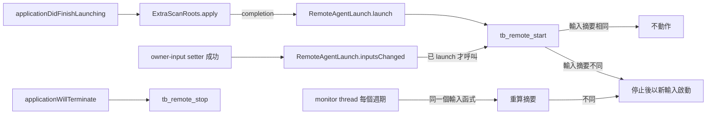

# Embedded remote-usage agent

## 文件目的

Syrtis 在 `tb_core_ffi` 內嵌 `syrtis-agent`（公開的 [Syrtis-Agent](https://github.com/Nanako0129/Syrtis-Agent/tree/d258e00118158d1464fe35324f7c98db97f464a8) ）：同一個行程裡一個 agent，負責配對、授權、Noise 傳輸、快取與分享開關。這份文件記錄它在 App 裡的接線：誰計算什麼、何時啟動與重啟、根目錄怎麼決定、C ABI 的形狀，以及驗證位置。它不重述 agent 的協定，那些以 agent repo 的 `spec/` 為準。

## 目錄

- [分層](#分層)
- [生命週期](#生命週期)
- [Agent 根目錄](#agent-根目錄)
- [C ABI](#c-abi)
- [遠端折入四頁](#遠端折入四頁)
- [Settings 的 Devices 頁](#settings-的-devices-頁)
- [Pricing 複製](#pricing-複製)
- [單一引擎與依賴 pin](#單一引擎與依賴-pin)
- [殘餘風險與未觀察的行為](#殘餘風險與未觀察的行為)
- [驗證](#驗證)

---

## 分層

| 層 | 計算什麼 | 不做什麼 |
|---|---|---|
| `syrtis-agent` | 配對、grant、授權判定、Noise 傳輸、receiver 快取、分享開關的狀態轉移、掃描範圍的核准紀錄、遠端報表（經由引擎） | 不讀環境變數；掃描輸入全由呼叫端給 |
| `tokscale-core`（vendor） | 掃描、解析、去重、計價、聚合，本機與遠端報表共用 | — |
| `crates/tb_core_ffi/src/remote_agent.rs` | 持有一個 `Agent`、轉換參數、呼叫 agent、把結果包進既有 JSON envelope、複製 pricing 檔、對單一 producer 呼叫 `Runtime::pull`／`last_good` | 不重做任何協定步驟；管理操作走 agent 自己的 control socket |
| `crates/tb_core_ffi/src/remote_pages.rs` | 逐 producer 檢查 record 是否在請求範圍內與筆數上限、交給 `merge::combine` 加總、把合併後的 record 以整數 saturating 加進本機 payload、重算衍生值、產生 `devices` | 不改本機那一份的計算（只選本機時直接跑既有函式）；不寫任何快取 |
| Swift（`RemoteAgentLaunch`、`TBCore`） | 決定 agent 根目錄、何時呼叫 start／stop、decode payload | 不計算任何授權或聚合；不過濾、不加總 |

凍結的 control 命令（offer create／cancel、pending list、approve、reject、revoke、listen configure、status）一律以 `control::Client` 打 agent 自己的 socket；control token 每次呼叫時從 state store 讀出、只留在記憶體裡。`remote_agent.rs` 直接呼叫的只有 `Runtime::enable_sharing`／`disable_sharing`、`Agent::approve_scope`、receiver 端的 `PairingClient` 與 `PeerStore`，以及一次 `set_listen_config`：凍結的 listen 命令不帶 node label，所以先送 listen 命令，再以讀回的 host 與 port 寫入 label。

## 生命週期

- **啟動時機**：`ExtraScanRoots.apply` 的 completion，也就是 scan registry 裝好之後；sharing 依 agent 儲存的狀態（新 root 為關），listener 只在儲存過 `bindHost` 時啟動。
- **輸入快照**：`tb_remote_start` 每次呼叫都在 agent 的鎖內重新讀取掃描輸入（`LocalSourceContext::scanner_settings`：extra scan roots、OpenCode DB、Cursor 接管），算出 `ownerInputsSha256`。與執行中的 agent 相同就不動作；不同就停止並以新輸入啟動，新輸入在 owner 核准前 `scopeApproved` 為 false，既有 grant 的報表請求被拒。
- **觸發重算的 setter**：`tb_set_extra_scan_paths` 成功之後（`ClaudeExtraRoots.install`，涵蓋 Claude、Pi、DSH 的 roots）與 `tb_set_cursor_sync` 成功之後（`CursorSync.coreSetConfig`）。launch 之前這兩處不啟動 agent。
- **週期重算**：沒有 setter 的輸入（手改 tokscale `settings.json` 的 `opencodeDbPaths`）由 monitor thread 負責。啟動時保存的那個輸入函式（同一個 home override、同一組來源）每個週期（產品 5 分鐘）再跑一次，與 `tb_remote_start` 走同一段 `ensure`：摘要相同不動作，不同就重啟，scope 隨之變成未核准。所以 owner 移除的資料庫最多再被分享一個週期。輸入無法再建立時（例如 override home 不再安全）agent 會被停止，不繼續以舊範圍服務。monitor 每個 `RemoteAgent` 一條、只持有弱參照，與 start 共用同一把鎖。monitor thread 開不起來時 start 會停掉剛啟動的 agent 並回 `internal`，不留下一個不會重算輸入的 agent。
- **停止**：`applicationWillTerminate` 在背景 queue 呼叫 `tb_remote_stop`，最多等 2 秒。
- **失敗**：啟動失敗（另一個行程持有 root 的 owner lock、root 不安全）只回 error envelope，App 其他功能不依賴 agent。`RemoteAgentLaunch` 以 `remote-agent` 類別的 Logger 記下失敗：只有純字母的類別字串以 public 記錄，其他一律記固定訊息。

## Agent 根目錄

`RemoteAgentLaunch.homeOverride` 是唯一的判定，App 與 selftest 共用：

| 條件 | 結果 |
|---|---|
| `BuildIdentity.shipping() != nil`（正式 bundle id、沒有 `--selftest`／`--smoke`／`--demo`／`--icon-gallery`）且非 `DEBUG` 建置 | `nil`：Rust 以 directory service 的 home 與凍結 suffix 開啟真正的 agent root |
| 其餘一律（裸執行檔、`make run`、selftest、暫時 bundle id、`DEBUG` 建置） | `/tmp/syrtis-agent-dev-<uid>/<bundle id 或 bare>`，root 為其下的 `a` |

開發用的目錄由 Rust 以 `0700` 建立；home 本身必須是本使用者擁有的實體目錄（不是 symlink），上層目錄必須屬於本使用者或 root。用 `/tmp` 與短 suffix 是因為 control socket 的路徑必須放進 macOS `sun_path` 的 104 bytes。macOS 開機時清空 `/tmp`，所以開發版的配對不會跨過重開機。`tb_core_ffi` 的測試建置收到 NULL home 時回 `homeRequired`，不開啟真正的 root。

## C ABI

全部回既有 envelope；`err` 只會是固定的類別字串，不含路徑、token、Pair URL 或位址。`tb_remote_*` 內的 panic 回 `panic`，不帶 panic 文字。只在 macOS 與 Linux 匯出（`#[cfg(unix)]`）；Windows 端（`SA-4`）目前沒有這些符號。

| 函式 | 成功資料 |
|---|---|
| `tb_remote_start(home_override)` | status 物件 |
| `tb_remote_stop()` | `{"running":false}` |
| `tb_remote_status()` | `{"running":false}`，或 control `status` 的欄位（含 agent 以 `Agent::scope_approved` 提供的 `scopeApproved`）加上 `running`、`listening`、`identityFingerprint` |
| `tb_remote_sharing_set(enabled)` | `null`；開啟中再開 → `invalid`，enable gate → `busy` |
| `tb_remote_listen_configure(host, port, node_label)` | status 物件 |
| `tb_remote_scope_disclosure()` | `{home, configDir, dataDir, extraScanPaths, excludedScanPaths, opencodeDbPaths, clients, ownerInputsSha256, envRootsSet, envRoots}` |
| `tb_remote_scope_approve(owner_inputs_sha256)` | `null`；摘要不是執行中 agent 的 → `invalid`、不寫入 |
| `tb_remote_offer_create(ttl_seconds)` | `{expiresAt, offerId, pairUrl}` |
| `tb_remote_offer_cancel(offer_id)`、`tb_remote_approve`／`tb_remote_reject(pending_id, sas_generation)`、`tb_remote_revoke(grant_id)` | control 命令的資料（`null`） |
| `tb_remote_pending_list()` | `[{expiresAt, pendingId, sasCode}]` |
| `tb_remote_grants()` | `[{grantId, peerFingerprint, createdAt, expiresAt, state}]`；`state`＝`active`／`revoked`／`expired`／`superseded`（紀錄仍是 active，但之後的掃描範圍核准把 generation 往前推、deny floor 提高，它已不能授權；Devices 頁只列 `active`，所以這種裝置不再顯示為可存取） |
| `tb_remote_pair_claim(pair_url)` | `{handle, sas, expiresAt, producerFingerprint}` |
| `tb_remote_pair_poll(handle)` | `{producerStatic, fingerprint, expiresAt}`；最多阻塞凍結的 960 秒 poll window，成功時寫入 `peers.json`。等待期間 agent 若換到另一個 identity 重啟 → `identityChanged`，什麼都不寫 |
| `tb_remote_peers()` | `[{producerStatic, fingerprint, nodeLabel, host, port, createdAt, expiresAt, state}]`；`host`／`port` 是配對時領取的邀請上的位址 |
| `tb_remote_peer_remove(producer_static)` | `null` |

指紋是 static key 的 SHA-256 前 8 bytes（16 個小寫 hex），給人比對用，不是識別碼。`envRoots` 列出本行程設定了哪些 client 的根目錄環境變數（`CODEX_HOME` 等）：本機頁面會跟著它們，分享的來源不會，所以 owner 在本機看到的與分享出去的可能不同。Swift 的 `RemoteOffer` 的 `description` 不含 `pairUrl`。

## 遠端折入四頁

四個帶裝置選擇的入口（`#[cfg(unix)]`），回傳既有 payload 的同一個形狀再加四個頂層 key：

| 函式 | 本機那一份 |
|---|---|
| `tb_graph_devices(year, devices_json, timezone, mode)` | 只選本機：`tb_graph` 的同一段（含 30 秒快取）；有選 producer：`usage_graph::compute` 重新計算，不讀也不寫 `GRAPH_CACHE` |
| `tb_model_report_devices(year, devices_json, timezone, mode)` | `model_report::run`／`compute` |
| `tb_hourly_report_devices(year, clients, devices_json, timezone, mode)` | `hourly_report::run`／`compute`；`clients` 也原樣送給 producer（排序、去重） |
| `tb_agents_report_devices(year, clients, devices_json, timezone, mode)` | `agents_report::run`／`compute`；同上 |

- `devices_json`＝`{"local": bool, "peers": ["<64 個小寫 hex 的 producerStatic>", …]}`：至少一個來源、`peers` 最多 16 個、不得重複，否則 `invalid`。`mode`＝`cached`（只用本機與各 producer 的 last-good，不連線）或 `refresh`（逐一 `Runtime::pull`，不用 `Agent::pull_all`：它拉所有 peer 且回傳已加總）。`timezone` 是 IANA 識別字，**呼叫端必須傳本機那一份計算時用的時區**（行程自己的時區）：遠端的時槽與日期用這個時區，本機的用行程的時區，兩者不同時會把兩個時區的時槽併進同一份 payload，而 Rust 端不檢查（判斷不出本機報表用的 IANA 名稱）。Swift 的包裝不開放這個參數，一律傳 `TimeZone.current.identifier`。先以引擎的 `aggregate_remote_usage_v1` 驗證查詢，內建 tzdb 不接受時該次所有 producer 標為 `incompatible`、不送出任何請求。
- 加上的 key：`devices`（每個來源一列 `{id, label, state, lastSuccessAt}`，本機在前、其餘依 `peers` 的順序）、`duplicateWarning`（選了兩個以上來源）、`saturated`（某個加總封頂）、`remoteRangeLimited`（all time）。只選本機時 data 與既有函式逐 byte 相同，另加這四個 key。
- `id`：`local`、producer static 的 16 hex 指紋，或 `peers`（`peers.json` 讀不到、agent 沒在跑時多出的說明列）。`label`：配對時存下的 `host:port`，本機為 `null`。`lastSuccessAt`：本行程內這個 producer、這個查詢最近一次 fresh 的 Unix 秒；行程重啟後未知。
- `state`：本機 `local`；拉取成功 `fresh`；拉取沒有回應而用 last-good、且 `lastSuccessAt` 已知 `lastGood`，未知 `stale`；沒有資料 `unavailable`（含筆數超過上限與記憶體預留失敗）；被拒（含 `Rejected`）`refused`；回覆無效或 record 落在請求範圍外 `invalidReply`；查詢不被接受 `incompatible`；同一個 `host:port` 有 `createdAt` 較新的紀錄（producer 重設身分後重新配對）`stale`，兩種模式都不讀也不送請求。
- 遠端範圍：指定年份＝該年 1 月 1 日到次年 1 月 1 日；all time＝到今天為止（end 為明天、不含）的 370 天，`remoteRangeLimited: true`。本機範圍不變。
- 每個 producer 的 record 先檢查再相加（凍結的 record 驗證不比對請求）：Graph 的 `date` 在 `[startDate, endDateExclusive)`、Hourly 的 `bucketStartUnixMs + utcOffsetSeconds`（時槽就是由它算出）在該範圍的毫秒視窗 `[startDate, endDateExclusive)` 之內（checked 運算），否則整個 producer 排除。凍結的驗證不限制 `utcOffsetSeconds`，只看 bucket 的話，producer 可以用好幾年的 offset 把數字挪進別年的時槽。不需要放寬：引擎只保留本地日期在範圍內的訊息，bucket 起點的本地日期與小時就是訊息的、offset 就是它回報的那個，所以正確的 record 的本地時間一定落在請求的日期。單一 producer 超過 32,768 筆、或累計超過 131,072 筆時，超過的那個 producer 整份排除。cached body 的 decode 與相加期間持有的 record 向 `remote_pages` 自己的 `MemoryLedger`（上限同 agent 的 384 MiB）預留；runtime 的 ledger 不公開。
- 相加：`merge::combine` 先把 producer 之間的 record 加總（u64、saturating），再加進本機：u64 轉 `i64`／`i32` 時封頂並設 `saturated`，`costNanoUsd` 只在最後一步轉成美元。Graph 依日期、client＋model＋provider 合併（`None` 與空字串視為同一個），重算 intensity（引擎同一條規則的副本，以 parity 測試釘住）、`calculate_summary`、`calculate_years` 與日期範圍。Models 依 client＋model＋provider 合併，`msPer1kTokens` 由合併後的 duration／timed tokens 重算；含遠端份量的列 `costEstimate` 一律為 `null`。Hourly 以 `bucketStartUnixMs + utcOffsetSeconds` 換成查詢時區的 `"YYYY-MM-DD HH:00"`（producer 以該時區算出 offset），`clients`／`models` 取聯集排序。Agents 依 agent 合併，`clients` 取聯集。排序與 total 依引擎的規則重算。
- `CheckGrantStatus`（錯誤碼 2）：以 `PeerRecord` 的 host、port、responder static 問一次 Grant status；`active` → `PeerStore::update_grant`，`revoked`／`expired` → `PeerStore::set_state`；不重拉，該列為 `refused`。
- 序列化：`remote_pages` 一把 mutex 讓 `refresh` 排隊（`cached` 不連線，不排隊）。agent 的 slot 是讀寫鎖：pull、last-good、peer 讀取與管理操作都拿讀鎖，所以一個卡住的 fetch 不擋 `cached` 呼叫或管理操作；只有輸入改變後的重啟與 `stop` 拿寫鎖，它們會等進行中的 fetch 結束（最多 `FETCH_DEADLINE` 135 秒），所以在舊 agent 上開始的 pull 不會寫進新的 agent。等寫鎖期間，之後的呼叫排在它後面。輸入沒變的 start 與 monitor 週期只拿讀鎖。
- 相加以 map 找列（Graph 每天的 client＋model＋provider、Models 的 client＋model＋provider、Hourly 的時槽、Agents 的 agent），clients／models 以集合收集後一次寫出，所以一個 producer 的 32,768 筆不同 record 不會讓折疊變成平方時間。
- Swift：`TBCore.graphDevices`／`modelReportDevices`／`hourlyReportDevices`／`agentsReportDevices` 回 `DeviceAwarePayload<T>`（`payload`、`devices: [RemoteDevice]`、三個旗標），不是頁面原本的型別，所以含遠端的資料不會進 `SnapshotStore`、不會取代 tray 與快照用的本機 payload。
- 查詢送給 producer 的只有凍結 request 已登記的欄位（範圍、時區、clients），而且只送給選中的 producer。

## Settings 的 Devices 頁

Settings sidebar 在 Accounts 與 General 之間的 Devices 頁（`DevicesSettingsView`）。頁面只呼叫 `TBCore.remote*`（經 `DevicesModel.swift` 的 `DevicesRemoteClient`），顯示回傳內容，並把固定的錯誤類別對應到 `DevicesCopy` 的文案；授權、摘要、配對與 grant 的判定都在 agent。`DevicesModel.shared` 是行程層級的單例（`SettingsPanel` 切頁會重建頁面），呼叫在背景 task 上進行；頁面顯示時每 2 秒輪詢刷新；頁面消失時取消的是這個輪詢 task，它進行中的那次刷新在每次呼叫之後檢查取消、不再呼叫也不寫入。由按鈕動作或配對等待結束觸發的單次刷新不屬於輪詢 task，頁面消失時不會被取消，會跑完並更新狀態；`tb_remote_pair_poll` 在自己的 `Thread` 上等待。

| 區塊 | 內容與規則 |
|---|---|
| 分享這台 Mac | 服務狀態與「重試」（`RemoteAgentLaunch.start` 同一條路徑）；分享開關只在 `scopeApproved` 時可開、關閉一律可按；裝置名稱（≤128 bytes）、監聽位址（`getifaddrs` 的非 loopback 位址加「僅本機」，不含 `0.0.0.0`／`::` 與需要 zone 的 IPv6 link-local）、port 1024–65535；沒有位址或 `listening` 為 false 時顯示連不到；公開 IPv4 或 global IPv6 顯示可能從網際網路連到。邀請：Pair URL 只存在 `DevicesModel.offer`，頁面消失或到期時清除並呼叫 `remoteOfferCancel`；建立邀請以世代編號綁定，頁面消失後或被較新的建立取代時才回來的結果不發布，並立即在 core 取消；複製時標記 concealed 與 transient，清除時只在 pasteboard 的 `changeCount` 仍是複製當下的值才清空。待核准列以 `pendingId` 為 identity，Approve／Reject 送出該列自己的 `pendingId`（`sasGeneration` 1）。已核准的 grant 可撤銷（有確認）。 |
| 掃描範圍 | `tb_remote_scope_disclosure` 的路徑與 client 清單、分享內容的說明、`envRootsSet` 的說明；核准送出按鈕所顯示那份揭露的 `ownerInputsSha256`（按下時由畫面帶入），回 `invalid` 時重新載入揭露、不自動重送。頁面開著時若某次刷新看到 `scopeApproved` 由 true 變 false，就重新載入揭露並顯示範圍已變更的說明；其他情況不重新載入。 |
| 已連結的裝置 | `tb_remote_peers` 的 `host:port`、指紋、狀態、到期日、移除（有確認）；貼上邀請（遮蔽輸入的 `SecureField`，≤16,384 bytes）→ claim → 顯示 SAS 並等待；取消只停止顯示，之後 poll 若成功就立刻 `remotePeerRemove`。殘餘：upsert 與 remove 之間的短暫空檔內可能已有一次拉取。 |

## Pricing 複製

來源是引擎的 pricing cache（`tokscale_core::pricing::cache::get_cache_dir()`）。啟動後把 `pricing-litellm.json` 與 `pricing-openrouter.json` 以暫存檔加 rename、`0600` 複製到 `Agent::pricing_dir()`；之後 monitor 在每個週期（5 分鐘）的輸入重算之後比較來源與目的地的 mtime，來源較新就再複製。來源不存在就略過。

> **已知限制（已量測）**：引擎的 remote pricing snapshot 依 dataset 內的 `timestamp`（不是檔案 mtime）拒收超過 3,600 秒的 dataset。以 fixture 量測：producer 的 pricing 為新的時，一則 1,000,000 input tokens 的 Claude Code 訊息分享出去的 cost 是 1.0 美元；把兩個 pricing 檔的 `timestamp` 改成 3,700 秒前、再被週期複製之後，同一則訊息分享出去的 cost 是 0（Claude Code 沒有自帶的 cost）。所以 App 一小時以上沒有刷新價格時，不自帶 cost 的 client 分享出去的 cost 為 0。

## 單一引擎與依賴 pin

`tb_core_ffi` 以 exact rev 依賴 `syrtis-agent`；workspace 的 `[patch."https://github.com/Nanako0129/tokscale-core"]` 把 agent 的引擎指向 `vendor/tokscale-core`，所以 binary 裡只有一份引擎。`scripts/check_agent_engine_pin.py`（CI 的「Agent engine pin」一步，先跑 `--self-test`）檢查三件事：

1. `vendor/tokscale-core` 的 gitlink 等於 agent 在該 rev 的 `Cargo.toml` 所 pin 的 `tokscale-core` rev。submodule 已 checkout 時，它的 `HEAD` 必須等於 gitlink（沒 stage 的 checkout 會被 Cargo 編進去）；沒 checkout（空目錄）時印出說明並以 gitlink 為準。
2. `Cargo.lock` 只有一個 `tokscale-core`，而且是 path 那一個。
3. agent 在 lock 裡的直接依賴必須正好是 snow、hmac、sha2、serde、serde_json、unicode-normalization、libc 加上引擎，多一個或少一個都 fail；這些非引擎依賴的閉包（以 name、version、source 辨識同一個 package）裡，每個 package 的 (name, version, source, checksum) 都等於 agent 在該 rev 的 `tests/fixtures/v1/runtime/storage/cargo-lock-baseline.json` 的某一筆。

推進 agent rev 或 engine pin 時三者要一起對上；第 3 條不符時，以 `cargo update -p <name>@<version> --precise <baseline version>` 對齊。

## 殘餘風險與未觀察的行為

- 本機以正式 bundle id 打包的 release 建置會被當成產品，使用真正的 agent root。
- `OPENCODE_DB` 是行程啟動時的環境變數，App 執行期間不會變；`settings.json` 的手改最多晚一個 monitor 週期（5 分鐘）生效。
- 以 `CLAUDE_CONFIG_DIR` 設定的 Claude config dir 經由同一次 `tb_set_extra_scan_paths` 進入掃描輸入，沒有另外的觸發點。
- 對真實 App 的啟動、結束與 setter 觸發沒有選單列 session 的驗收；selftest 只走同一條 start 路徑。
- Devices 頁的畫面、深淺色與「減少透明度」下的對比、關閉 Settings 視窗時是否觸發 `onDisappear`，以及與第二台機器的實際配對，都還沒有實機觀察；selftest 只驅動 model。
- 四頁的裝置選擇還沒有畫面（`SA-3d`）；`refresh` 對真實網路（非 loopback）與真實 session 量的耗時沒有量測。
- Grant status 回 `revoked`／`expired` 的分支只經程式閱讀：producer 對被撤銷或到期的 grant 直接回錯誤碼 3／4，測試做不出錯誤碼 2 之後又是 `revoked` 的時序。
- 選了 producer 時本機那一份每次重新掃描（不經 `GRAPH_CACHE`），比只選本機慢。

## 驗證

| 項目 | 位置 |
|---|---|
| 兩個 agent 配對、SAS、approve、poll、peers、revoke；輸入變更後重啟且舊 grant 的報表被拒 | `remote_agent::tests::two_agents_pair_a_changed_scope_is_refused_and_revoke_ends_the_grant` |
| FFI：新 root 的 status、重複 start 不重啟、揭露 extra roots、同輸入同摘要、錯的摘要被拒、stop、不安全 root 的類別字串 | `remote_agent::tests::ffi_lifecycle_disclosure_scope_approval_and_errors` |
| 輸入全來自 fixture：fixture `settings.json` 的 sentinel 資料庫正是揭露的清單、揭露的路徑都在 temp root 內、pricing 從 fixture cache 複製 | `remote_agent::tests::ffi_disclosure_holds_only_fixture_inputs` |
| 手改 `settings.json` 的 OpenCode 清單：一個週期內重啟、scope 未核准、舊 grant 的報表被拒；檔案不變則不重啟 | `remote_agent::tests::a_hand_edit_of_the_opencode_list_restarts_within_one_period` |
| listen 設定經凍結命令、舊 port 不再接受連線 | `remote_agent::tests::listen_configure_moves_the_listener_off_the_old_port` |
| pricing 複製與週期更新 | `remote_agent::tests::pricing_is_copied_at_start_and_again_when_the_source_is_newer` |
| panic 只回固定類別 | `remote_agent::tests::a_panic_is_the_fixed_class_without_its_text` |
| monitor 開不起來時不留下執行中的 agent | `remote_agent::tests::a_monitor_that_cannot_start_stops_the_agent` |
| poll 等待期間換 home 重啟：`identityChanged`、新 home 的 peer store 沒有紀錄 | `remote_agent::tests::a_poll_that_ends_after_a_restart_on_another_home_writes_nothing` |
| 根目錄判定、selftest 走同一條 start 路徑（在 fixture 子行程裡，含 sentinel 檢查；fixture root 以 0700 獨佔建立）、真正的 root 在 selftest 前後「不存在」或「存在且修改時間相同」（只比對這兩項；偵測不到對其下既有檔案的讀取或修改） | SelfTest 的 `SA3A` 案例 |
| 只選本機：四個新入口的 data 與既有函式逐 byte 相同 | `remote_pages::tests::local_only_is_the_existing_output_byte_for_byte` |
| 兩個 producer：只選一個只有它的數值、未選的 peer 沒有連線；本機＋producer 逐欄相加（重疊與不重疊）；只選 producer；Asia/Tokyo 跨日時槽；`incompatible` 不送請求；`unavailable`；被撤銷的 `refused` 只排除自己；producer 停掉後 `cached` 與 `refresh` 都回 `lastGood`；重啟後 `stale` 且 `lastSuccessAt` 為 null | `remote_pages::tests::producers_fold_into_the_four_pages` |
| 範圍外的 record、筆數上限只排除該 producer；`state` 對應表；saturating；intensity parity；含遠端的 model 列沒有 `costEstimate` | `remote_pages::tests::*`（純函式） |
| 同 `host:port` 較新的紀錄：舊紀錄兩種模式都不讀、不送請求 | `remote_pages::tests::a_superseded_record_is_never_read_or_asked` |
| 範圍內的 bucket 帶一年的 offset：該 producer 整份排除，本機較舊的時槽不變 | `remote_pages::tests::an_in_range_bucket_with_an_offset_of_a_year_is_left_out` |
| 握手後不回應的 producer：`refresh` 等待期間，`cached` 呼叫與 `peer_remove` 在 2 秒內返回 | `remote_pages::tests::a_silent_producer_blocks_neither_cached_calls_nor_management` |
| 每頁 32,768 筆不同 record 的折疊在 2 秒內 | `remote_pages::tests::folds_of_32768_distinct_records_are_not_quadratic` |
| `peers.json` 讀不到：`peers` 說明列 | `remote_pages::tests::an_unreadable_peer_store_is_said` |
| 錯誤碼 2 之後 Grant status 更新 `authEpoch` | `remote_pages::tests::check_grant_status_updates_the_record` |
| pricing 超過一小時時分享出去的 cost | `remote_pages::tests::shared_cost_with_fresh_and_hour_old_pricing` |
| Swift decode、含遠端的列沒有 implausible-cost ratio；四個呼叫前後，快照目錄與其中各檔的大小與修改時間相同（只比對 metadata，不比對內容：Foundation 的 Caches 目錄不跟隨 `HOME`，selftest 子行程看到的是使用者真正的目錄） | SelfTest 的 `SA3B` 案例 |
| `tb_remote_peers` 每列帶 record 的 `host` 與 `port` | `remote_agent::tests::peers_rows_carry_the_record_host_and_port` |
| Devices 頁：sidebar 位置、三語文案、狀態機（未啟動→重試、未核准→開關不可用、核准後可開、錯誤類別對應）、Pair URL 不在 description／UserDefaults 且到期與頁面消失時清除並取消、離開頁面後完成的等待、取消後成功即移除、列綁定、核准綁定、監聽選單（全部以假 client 與假 pasteboard 驅動） | SelfTest 的 `SA3C` 案例 |
| pin 與 lock 閉包 | `python3 scripts/check_agent_engine_pin.py --self-test` 與不帶參數的執行 |

經過 App 自己的來源（`Sources::app`、`LocalSourceContext`）的測試都在清空環境的子行程裡跑：`HOME` 與 `TOKSCALE_CONFIG_DIR` 指向測試建立的 temp root，所以 OpenCode `settings.json`、`OPENCODE_DB`、Cursor 與 extra-root registry、pricing cache 都是 fixture。直接建立 `Inputs` 的測試不經過那些來源。selftest 的 start 案例以同樣方式啟動自己的子行程。
