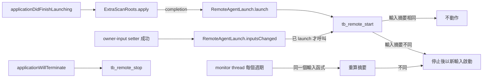

# Embedded remote-usage agent

## 文件目的

Syrtis 在 `tb_core_ffi` 內嵌 `syrtis-agent`（公開的 [Syrtis-Agent](https://github.com/Nanako0129/Syrtis-Agent/tree/f424877dad0ff6490a0b9e011806604a0ae695d8) ）：同一個行程裡一個 agent，負責配對、授權、Noise 傳輸、快取與分享開關。這份文件記錄它在 App 裡的接線：誰計算什麼、何時啟動與重啟、根目錄怎麼決定、C ABI 的形狀，以及驗證位置。它不重述 agent 的協定，那些以 agent repo 的 `spec/` 為準。

## 目錄

- [分層](#分層)
- [生命週期](#生命週期)
- [Agent 根目錄](#agent-根目錄)
- [C ABI](#c-abi)
- [Pricing 複製](#pricing-複製)
- [單一引擎與依賴 pin](#單一引擎與依賴-pin)
- [殘餘風險與未觀察的行為](#殘餘風險與未觀察的行為)
- [驗證](#驗證)

---

## 分層

| 層 | 計算什麼 | 不做什麼 |
|---|---|---|
| `syrtis-agent` | 配對、grant、授權判定、Noise 傳輸、receiver 快取、分享開關的狀態轉移、掃描範圍的核准紀錄、遠端報表（經由引擎） | 不讀環境變數；掃描輸入全由呼叫端給 |
| `tokscale-core`（vendor） | 掃描、解析、去重、計價、聚合，本機與遠端報表共用 | — |
| `crates/tb_core_ffi/src/remote_agent.rs` | 持有一個 `Agent`、轉換參數、呼叫 agent、把結果包進既有 JSON envelope、複製 pricing 檔 | 不重做任何協定步驟；管理操作走 agent 自己的 control socket |
| Swift（`RemoteAgentLaunch`、`TBCore`） | 決定 agent 根目錄、何時呼叫 start／stop、decode payload | 不計算任何授權或聚合 |

凍結的 control 命令（offer create／cancel、pending list、approve、reject、revoke、listen configure、status）一律以 `control::Client` 打 agent 自己的 socket；control token 每次呼叫時從 state store 讀出、只留在記憶體裡。`remote_agent.rs` 直接呼叫的只有 `Runtime::enable_sharing`／`disable_sharing`、`Agent::approve_scope`、receiver 端的 `PairingClient` 與 `PeerStore`，以及一次 `set_listen_config`：凍結的 listen 命令不帶 node label，所以先送 listen 命令，再以讀回的 host 與 port 寫入 label。

## 生命週期

- **啟動時機**：`ExtraScanRoots.apply` 的 completion，也就是 scan registry 裝好之後；sharing 依 agent 儲存的狀態（新 root 為關），listener 只在儲存過 `bindHost` 時啟動。
- **輸入快照**：`tb_remote_start` 每次呼叫都在 agent 的鎖內重新讀取掃描輸入（`LocalSourceContext::scanner_settings`：extra scan roots、OpenCode DB、Cursor 接管），算出 `ownerInputsSha256`。與執行中的 agent 相同就不動作；不同就停止並以新輸入啟動，新輸入在 owner 核准前 `scopeApproved` 為 false，既有 grant 的報表請求被拒。
- **觸發重算的 setter**：`tb_set_extra_scan_paths` 成功之後（`ClaudeExtraRoots.install`，涵蓋 Claude、Pi、DSH 的 roots）與 `tb_set_cursor_sync` 成功之後（`CursorSync.coreSetConfig`）。launch 之前這兩處不啟動 agent。
- **週期重算**：沒有 setter 的輸入（手改 tokscale `settings.json` 的 `opencodeDbPaths`）由 monitor thread 負責。啟動時保存的那個輸入函式（同一個 home override、同一組來源）每個週期（產品 5 分鐘）再跑一次，與 `tb_remote_start` 走同一段 `ensure`：摘要相同不動作，不同就重啟，scope 隨之變成未核准。所以 owner 移除的資料庫最多再被分享一個週期。輸入無法再建立時（例如 override home 不再安全）agent 會被停止，不繼續以舊範圍服務。monitor 每個 `RemoteAgent` 一條、只持有弱參照，與 start 共用同一把鎖。monitor thread 開不起來時 start 會停掉剛啟動的 agent 並回 `internal`，不留下一個不會重算輸入的 agent。
- **停止**：`applicationWillTerminate` 在背景 queue 呼叫 `tb_remote_stop`，最多等 2 秒。
- **失敗**：啟動失敗（另一個行程持有 root 的 owner lock、root 不安全）只回 error envelope，App 其他功能不依賴 agent。`RemoteAgentLaunch` 以 `remote-agent` 類別的 Logger 記下失敗：只有純字母的類別字串以 public 記錄，其他一律記固定訊息。

## Agent 根目錄

`RemoteAgentLaunch.homeOverride` 是唯一的判定，App 與 selftest 共用：

| 條件 | 結果 |
|---|---|
| `BuildIdentity.shipping() != nil`（正式 bundle id、沒有 `--selftest`／`--smoke`／`--demo`／`--icon-gallery`）且非 `DEBUG` 建置 | `nil`：Rust 以 directory service 的 home 與凍結 suffix 開啟真正的 agent root |
| 其餘一律（裸執行檔、`make run`、selftest、暫時 bundle id、`DEBUG` 建置） | `/tmp/syrtis-agent-dev-<uid>/<bundle id 或 bare>`，root 為其下的 `a` |

開發用的目錄由 Rust 以 `0700` 建立；home 本身必須是本使用者擁有的實體目錄（不是 symlink），上層目錄必須屬於本使用者或 root。用 `/tmp` 與短 suffix 是因為 control socket 的路徑必須放進 macOS `sun_path` 的 104 bytes。macOS 開機時清空 `/tmp`，所以開發版的配對不會跨過重開機。`tb_core_ffi` 的測試建置收到 NULL home 時回 `homeRequired`，不開啟真正的 root。

## C ABI

全部回既有 envelope；`err` 只會是固定的類別字串，不含路徑、token、Pair URL 或位址。`tb_remote_*` 內的 panic 回 `panic`，不帶 panic 文字。只在 macOS 與 Linux 匯出（`#[cfg(unix)]`）；Windows 端（`SA-4`）目前沒有這些符號。

| 函式 | 成功資料 |
|---|---|
| `tb_remote_start(home_override)` | status 物件 |
| `tb_remote_stop()` | `{"running":false}` |
| `tb_remote_status()` | `{"running":false}`，或 control `status` 的欄位加上 `running`、`scopeApproved`、`listening`、`identityFingerprint` |
| `tb_remote_sharing_set(enabled)` | `null`；開啟中再開 → `invalid`，enable gate → `busy` |
| `tb_remote_listen_configure(host, port, node_label)` | status 物件 |
| `tb_remote_scope_disclosure()` | `{home, configDir, dataDir, extraScanPaths, excludedScanPaths, opencodeDbPaths, clients, ownerInputsSha256, envRootsSet, envRoots}` |
| `tb_remote_scope_approve(owner_inputs_sha256)` | `null`；摘要不是執行中 agent 的 → `invalid`、不寫入 |
| `tb_remote_offer_create(ttl_seconds)` | `{expiresAt, offerId, pairUrl}` |
| `tb_remote_offer_cancel(offer_id)`、`tb_remote_approve`／`tb_remote_reject(pending_id, sas_generation)`、`tb_remote_revoke(grant_id)` | control 命令的資料（`null`） |
| `tb_remote_pending_list()` | `[{expiresAt, pendingId, sasCode}]` |
| `tb_remote_grants()` | `[{grantId, peerFingerprint, createdAt, expiresAt, state}]` |
| `tb_remote_pair_claim(pair_url)` | `{handle, sas, expiresAt, producerFingerprint}` |
| `tb_remote_pair_poll(handle)` | `{producerStatic, fingerprint, expiresAt}`；最多阻塞凍結的 960 秒 poll window，成功時寫入 `peers.json`。等待期間 agent 若換到另一個 identity 重啟 → `identityChanged`，什麼都不寫 |
| `tb_remote_peers()` | `[{producerStatic, fingerprint, nodeLabel, createdAt, expiresAt, state}]` |
| `tb_remote_peer_remove(producer_static)` | `null` |

指紋是 static key 的 SHA-256 前 8 bytes（16 個小寫 hex），給人比對用，不是識別碼。`envRoots` 列出本行程設定了哪些 client 的根目錄環境變數（`CODEX_HOME` 等）：本機頁面會跟著它們，分享的來源不會，所以 owner 在本機看到的與分享出去的可能不同。Swift 的 `RemoteOffer` 的 `description` 不含 `pairUrl`。

## Pricing 複製

來源是引擎的 pricing cache（`tokscale_core::pricing::cache::get_cache_dir()`）。啟動後把 `pricing-litellm.json` 與 `pricing-openrouter.json` 以暫存檔加 rename、`0600` 複製到 `Agent::pricing_dir()`；之後 monitor 在每個週期（5 分鐘）的輸入重算之後比較來源與目的地的 mtime，來源較新就再複製。來源不存在就略過。

> **已知限制**：引擎的 remote pricing snapshot 拒收超過 3,600 秒的 dataset。App 長時間沒有刷新價格時，分享出去的 cost 會退回 parser 自帶的值或 0。這一點尚未以真實資料量測，`SA-3b` 接上真實資料後量測。

## 單一引擎與依賴 pin

`tb_core_ffi` 以 exact rev 依賴 `syrtis-agent`；workspace 的 `[patch."https://github.com/Nanako0129/tokscale-core"]` 把 agent 的引擎指向 `vendor/tokscale-core`，所以 binary 裡只有一份引擎。`scripts/check_agent_engine_pin.py`（CI 的「Agent engine pin」一步，先跑 `--self-test`）檢查三件事：

1. `vendor/tokscale-core` 的 gitlink 等於 agent 在該 rev 的 `Cargo.toml` 所 pin 的 `tokscale-core` rev。submodule 已 checkout 時，它的 `HEAD` 必須等於 gitlink（沒 stage 的 checkout 會被 Cargo 編進去）；沒 checkout（空目錄）時印出說明並以 gitlink 為準。
2. `Cargo.lock` 只有一個 `tokscale-core`，而且是 path 那一個。
3. agent 在 lock 裡的直接依賴必須正好是 snow、hmac、sha2、serde、serde_json、unicode-normalization、libc 加上引擎，多一個或少一個都 fail；這些非引擎依賴的閉包（以 name、version、source 辨識同一個 package）裡，每個 package 的 (name, version, source, checksum) 都等於 agent 在該 rev 的 `tests/fixtures/v1/runtime/storage/cargo-lock-baseline.json` 的某一筆。

推進 agent rev 或 engine pin 時三者要一起對上；第 3 條不符時，以 `cargo update -p <name>@<version> --precise <baseline version>` 對齊。

## 殘餘風險與未觀察的行為

- 本機以正式 bundle id 打包的 release 建置會被當成產品，使用真正的 agent root。
- `OPENCODE_DB` 是行程啟動時的環境變數，App 執行期間不會變；`settings.json` 的手改最多晚一個 monitor 週期（5 分鐘）生效。
- 以 `CLAUDE_CONFIG_DIR` 設定的 Claude config dir 經由同一次 `tb_set_extra_scan_paths` 進入掃描輸入，沒有另外的觸發點。
- 對真實 App 的啟動、結束與 setter 觸發沒有選單列 session 的驗收；selftest 只走同一條 start 路徑。

## 驗證

| 項目 | 位置 |
|---|---|
| 兩個 agent 配對、SAS、approve、poll、peers、revoke；輸入變更後重啟且舊 grant 的報表被拒 | `remote_agent::tests::two_agents_pair_a_changed_scope_is_refused_and_revoke_ends_the_grant` |
| FFI：新 root 的 status、重複 start 不重啟、揭露 extra roots、同輸入同摘要、錯的摘要被拒、stop、不安全 root 的類別字串 | `remote_agent::tests::ffi_lifecycle_disclosure_scope_approval_and_errors` |
| 輸入全來自 fixture：fixture `settings.json` 的 sentinel 資料庫正是揭露的清單、揭露的路徑都在 temp root 內、pricing 從 fixture cache 複製 | `remote_agent::tests::ffi_disclosure_holds_only_fixture_inputs` |
| 手改 `settings.json` 的 OpenCode 清單：一個週期內重啟、scope 未核准、舊 grant 的報表被拒；檔案不變則不重啟 | `remote_agent::tests::a_hand_edit_of_the_opencode_list_restarts_within_one_period` |
| listen 設定經凍結命令、舊 port 不再接受連線 | `remote_agent::tests::listen_configure_moves_the_listener_off_the_old_port` |
| pricing 複製與週期更新 | `remote_agent::tests::pricing_is_copied_at_start_and_again_when_the_source_is_newer` |
| panic 只回固定類別 | `remote_agent::tests::a_panic_is_the_fixed_class_without_its_text` |
| monitor 開不起來時不留下執行中的 agent | `remote_agent::tests::a_monitor_that_cannot_start_stops_the_agent` |
| poll 等待期間換 home 重啟：`identityChanged`、新 home 的 peer store 沒有紀錄 | `remote_agent::tests::a_poll_that_ends_after_a_restart_on_another_home_writes_nothing` |
| 根目錄判定、selftest 走同一條 start 路徑（在 fixture 子行程裡，含 sentinel 檢查；fixture root 以 0700 獨佔建立）、真正的 root 在 selftest 前後「不存在」或「存在且修改時間相同」（只比對這兩項；偵測不到對其下既有檔案的讀取或修改） | SelfTest 的 `SA3A` 案例 |

經過 App 自己的來源（`Sources::app`、`LocalSourceContext`）的測試都在清空環境的子行程裡跑：`HOME` 與 `TOKSCALE_CONFIG_DIR` 指向測試建立的 temp root，所以 OpenCode `settings.json`、`OPENCODE_DB`、Cursor 與 extra-root registry、pricing cache 都是 fixture。直接建立 `Inputs` 的測試不經過那些來源。selftest 的 start 案例以同樣方式啟動自己的子行程。
| pin 與 lock 閉包 | `python3 scripts/check_agent_engine_pin.py --self-test` 與不帶參數的執行 |
